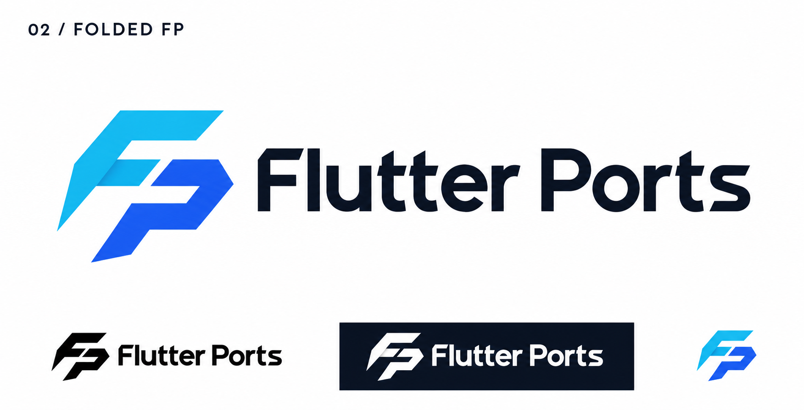
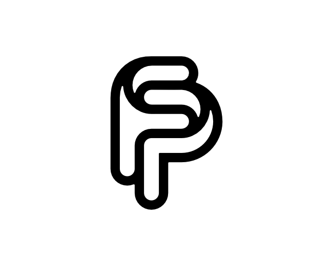

# 02-folded-fp — Folded FP

[All concepts](../README.md) · [Full-size concept](concept.png) · [Original prompt](prompt.txt) · [Sources and hashes](references/sources.json)

**Visual assessment: Known requested style; related monogram.**

| Our generated concept | Existing work for comparison |
| --- | --- |
|  | **[Flutter](https://docs.flutter.dev/brand)**   **[FP/PF monogram — proffartline](https://logopond.com/proffartline/showcase/detail/314319)**  |

## What is similar, and what differs

Flutter shares the blue folded 45-degree ribbon vocabulary; the FP reference shares interwoven initials. Our sharp double-letter silhouette differs from both. Neither comparison proves a copied source.

## Actual generation provenance

The text prompt explicitly requested Flutter-like geometry while asking for a distinct FP symbol. No external image was passed for this initial concept.

An existing brand named in a negative prompt (for example, “do not resemble …”) is an exclusion, not evidence that its image was used.

## Search record

Reviewed 2026-11-02. Preliminary descriptive web/image search and direct visual comparison; not reverse-image search or proof of provenance.

Search queries used for this design or its family:

- Flutter logo official
- FP monogram logo rounded

A missing close match means only that this bounded search did not establish one. It is not a uniqueness claim. Comparisons can be historical marks or shared design archetypes; refer to the source metadata for versions and attribution.
