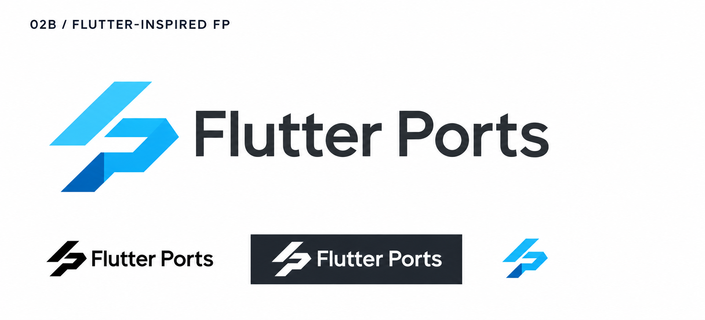

# 02b-flutter-inspired-fp — Flutter-inspired FP

[All concepts](../README.md) · [Full-size concept](concept.png) · [Original prompt](prompt.txt) · [Sources and hashes](references/sources.json)

**Visual assessment: Known requested style; close geometric vocabulary.**

| Our generated concept | Existing work for comparison |
| --- | --- |
|  | **[Flutter](https://docs.flutter.dev/brand)**  |

## What is similar, and what differs

The cyan diagonal stroke, separated lower fold and blue planes are deliberately close to Flutter's visual language. The lower P-shaped return changes the silhouette. This is a requested stylistic reference, not a discovered hidden source.

## Actual generation provenance

User explicitly requested greater similarity to Flutter. Generated as an edit of 02.

Earlier concept inputs:

- [02-folded-fp](references/input-02-folded-fp.png)

An existing brand named in a negative prompt (for example, “do not resemble …”) is an exclusion, not evidence that its image was used.

## Search record

Reviewed 2026-11-02. Preliminary descriptive web/image search and direct visual comparison; not reverse-image search or proof of provenance.

Search queries used for this design or its family:

- Flutter logo official

A missing close match means only that this bounded search did not establish one. It is not a uniqueness claim. Comparisons can be historical marks or shared design archetypes; refer to the source metadata for versions and attribution.
