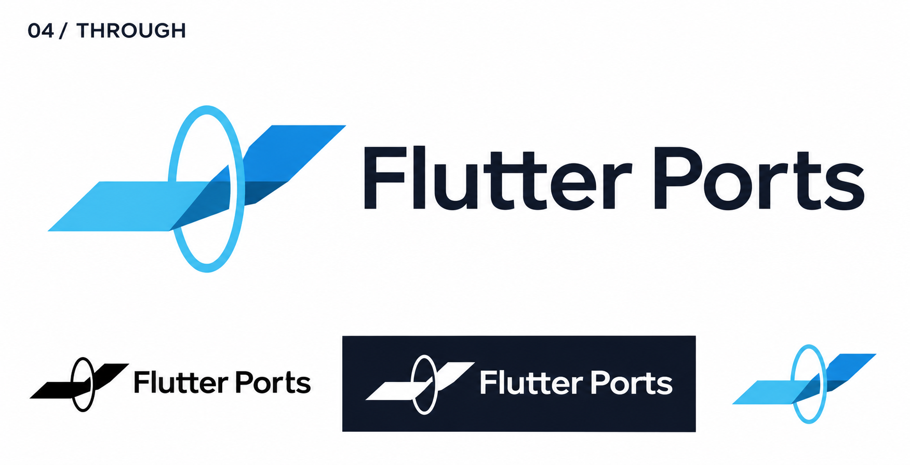
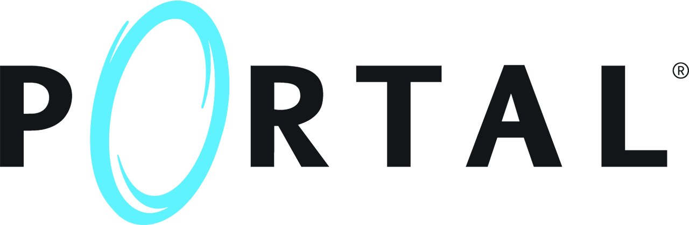

# 04-through — Through

[All concepts](../README.md) · [Full-size concept](concept.png) · [Original prompt](prompt.txt) · [Sources and hashes](references/sources.json)

**Visual assessment: Known conceptual and stylistic references.**

| Our generated concept | Existing work for comparison |
| --- | --- |
|  | **[Portal wordmark](https://store.steampowered.com/app/400/Portal/)**   **[Flutter](https://docs.flutter.dev/brand)**  |

## What is similar, and what differs

Portal supplies the passage-through-an-oval idea; Flutter supplies angular blue ribbons. Our horizontal ribbon crossing a vertical ring is not either source's logo silhouette. The saved Portal wordmark is a franchise comparison, not the exact screenshot supplied by the user.

## Actual generation provenance

The user supplied a Portal-game image as thematic inspiration. The prompt also requested Flutter-like ribbon geometry.

An existing brand named in a negative prompt (for example, “do not resemble …”) is an exclusion, not evidence that its image was used.

## Search record

Reviewed 2026-11-02. Preliminary descriptive web/image search and direct visual comparison; not reverse-image search or proof of provenance.

Search queries used for this design or its family:

- Portal game logo aperture
- Flutter logo official

A missing close match means only that this bounded search did not establish one. It is not a uniqueness claim. Comparisons can be historical marks or shared design archetypes; refer to the source metadata for versions and attribution.
