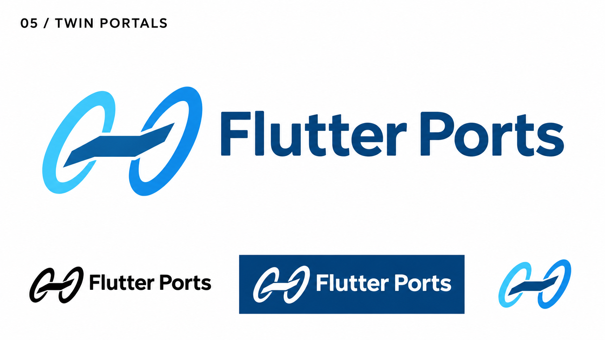
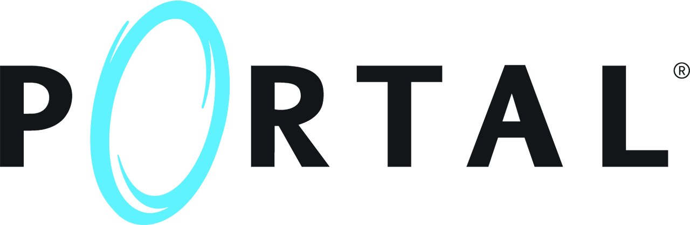

# 05-twin-portals — Twin Portals

[All concepts](../README.md) · [Full-size concept](concept.png) · [Original prompt](prompt.txt) · [Sources and hashes](references/sources.json)

**Visual assessment: Known conceptual reference.**

| Our generated concept | Existing work for comparison |
| --- | --- |
|  | **[Portal wordmark](https://store.steampowered.com/app/400/Portal/)**  |

## What is similar, and what differs

The blue oval passage motif comes from the requested Portal theme. Our paired tilted rings and connecting ribbon are different from the game's wordmark. No close full-logo match was established in this bounded search.

## Actual generation provenance

The user-supplied Portal-game image was a conceptual reference. This saved official wordmark is not the identical input screenshot.

An existing brand named in a negative prompt (for example, “do not resemble …”) is an exclusion, not evidence that its image was used.

## Search record

Reviewed 2026-11-02. Preliminary descriptive web/image search and direct visual comparison; not reverse-image search or proof of provenance.

Search queries used for this design or its family:

- Portal game logo aperture

A missing close match means only that this bounded search did not establish one. It is not a uniqueness claim. Comparisons can be historical marks or shared design archetypes; refer to the source metadata for versions and attribution.
