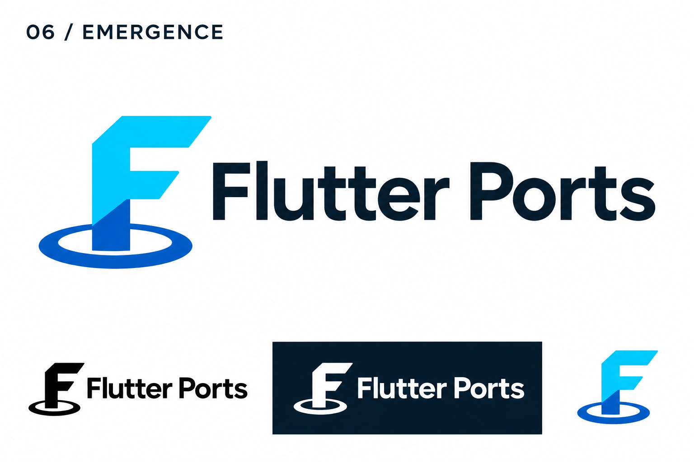

# 06-emergence — Emergence

[All concepts](../README.md) · [Full-size concept](concept.png) · [Original prompt](prompt.txt) · [Sources and hashes](references/sources.json)

**Visual assessment: Known conceptual and stylistic references.**

| Our generated concept | Existing work for comparison |
| --- | --- |
|  | **[Flutter](https://docs.flutter.dev/brand)**   **[Portal wordmark](https://store.steampowered.com/app/400/Portal/)**  |

## What is similar, and what differs

The full upright F over a horizontal ellipse differs from Flutter's split diagonal F and from Portal's wordmark. Shared references are Flutter's blue folded letter vocabulary and the requested portal-emergence idea; neither is an exact source for this composition.

## Actual generation provenance

Portal-game reference supplied by the user; readable F and Flutter-like cut ends specified in the prompt.

An existing brand named in a negative prompt (for example, “do not resemble …”) is an exclusion, not evidence that its image was used.

## Search record

Reviewed 2026-11-02. Preliminary descriptive web/image search and direct visual comparison; not reverse-image search or proof of provenance.

Search queries used for this design or its family:

- Portal game logo aperture
- Flutter logo official

A missing close match means only that this bounded search did not establish one. It is not a uniqueness claim. Comparisons can be historical marks or shared design archetypes; refer to the source metadata for versions and attribution.
