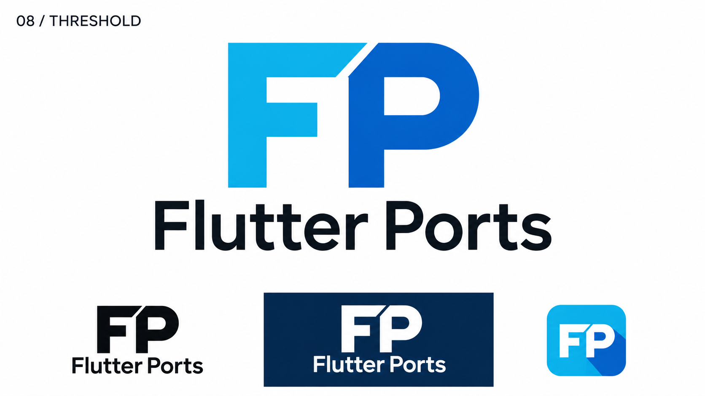
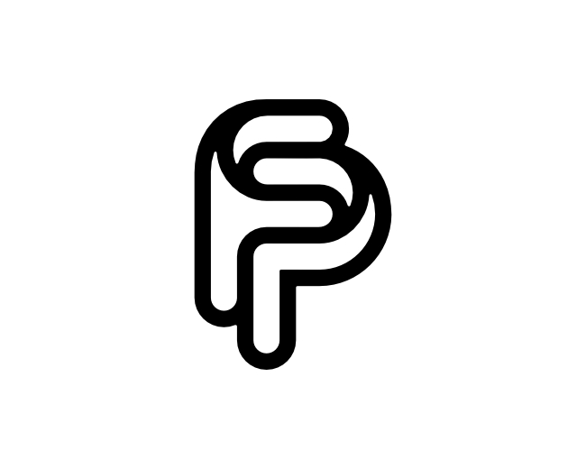

# 08-threshold-fp — Threshold FP

[All concepts](../README.md) · [Full-size concept](concept.png) · [Original prompt](prompt.txt) · [Sources and hashes](references/sources.json)

**Visual assessment: Shared initials; no close match found.**

| Our generated concept | Existing work for comparison |
| --- | --- |
|  | **[FP/PF monogram — proffartline](https://logopond.com/proffartline/showcase/detail/314319)**  |

## What is similar, and what differs

The reference establishes existing FP monogram work, but is a curved outline sharing strokes. Ours is two upright bold letters divided by a diagonal cut. Similar initials alone do not establish copying, and this is not a close contour match.

## Actual generation provenance

Text-generated from a readable FP/shared-cut brief; no external logo image input.

An existing brand named in a negative prompt (for example, “do not resemble …”) is an exclusion, not evidence that its image was used.

## Search record

Reviewed 2026-11-02. Preliminary descriptive web/image search and direct visual comparison; not reverse-image search or proof of provenance.

Search queries used for this design or its family:

- FP monogram logo rounded

A missing close match means only that this bounded search did not establish one. It is not a uniqueness claim. Comparisons can be historical marks or shared design archetypes; refer to the source metadata for versions and attribution.
