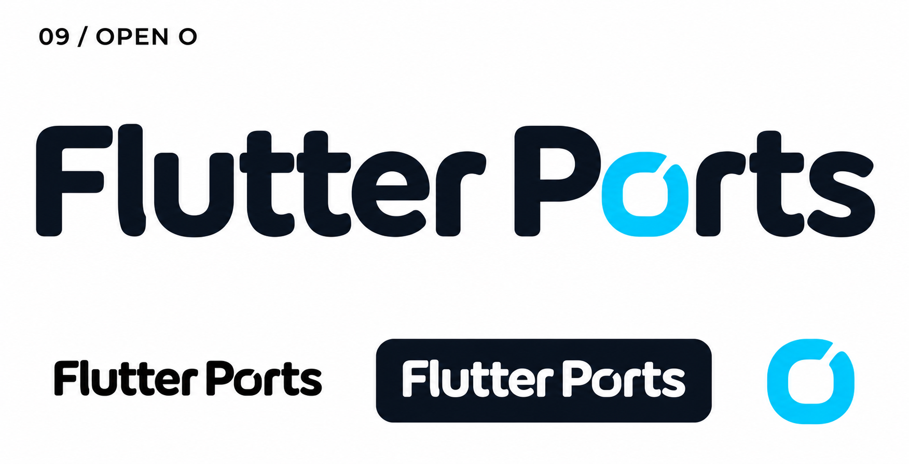
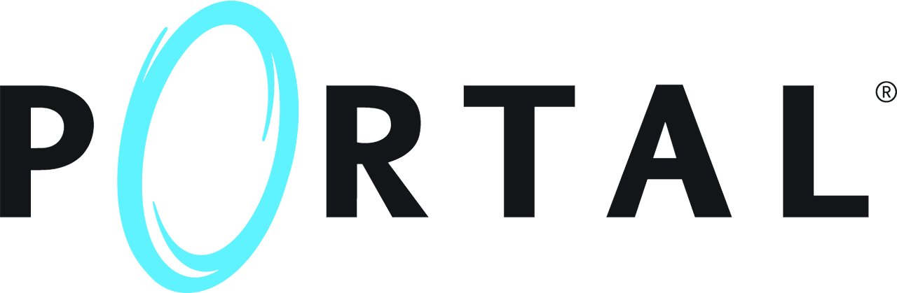
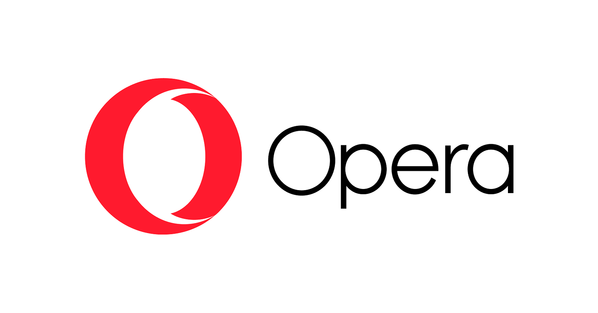

# 09-open-o — Open O

[All concepts](../README.md) · [Full-size concept](concept.png) · [Original prompt](prompt.txt) · [Sources and hashes](references/sources.json)

**Visual assessment: Related letter-as-symbol device.**

| Our generated concept | Existing work for comparison |
| --- | --- |
|  | **[Portal wordmark](https://store.steampowered.com/app/400/Portal/)**   **[Opera](https://www.sec.gov/Archives/edgar/data/1737450/000173745025000003/opra-ex99_1.htm)**  |

## What is similar, and what differs

Portal replaces O with a blue oval; Opera uses an O/ring as its mark. Our cut cyan lowercase o uses the same broad device but different contour, cut and full wordmark. Neither reference establishes an exact match.

## Actual generation provenance

Text-generated wordmark concept; the brief carried the earlier portal theme. No external logo image input for this asset.

An existing brand named in a negative prompt (for example, “do not resemble …”) is an exclusion, not evidence that its image was used.

## Search record

Reviewed 2026-11-02. Preliminary descriptive web/image search and direct visual comparison; not reverse-image search or proof of provenance.

Search queries used for this design or its family:

- Portal game logo aperture
- Opera logo official

A missing close match means only that this bounded search did not establish one. It is not a uniqueness claim. Comparisons can be historical marks or shared design archetypes; refer to the source metadata for versions and attribution.
