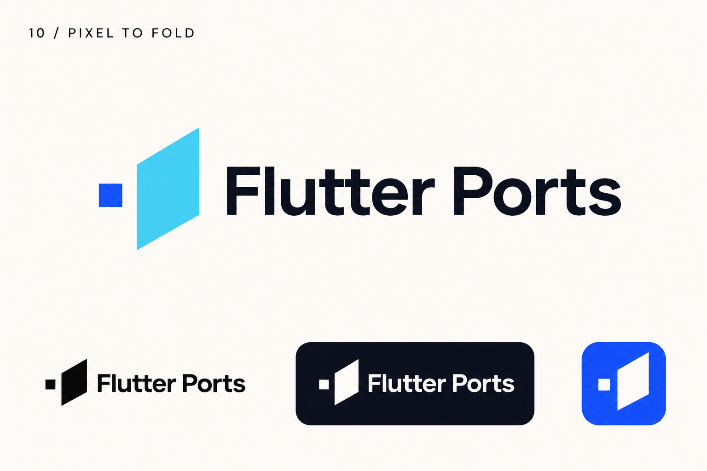

# 10-pixel-fold — Pixel to Fold

[All concepts](../README.md) · [Full-size concept](concept.png) · [Original prompt](prompt.txt) · [Sources and hashes](references/sources.json)

**Visual assessment: Shared primitives; no close match found.**

| Our generated concept | Existing work for comparison |
| --- | --- |
|  | **[Scanmarker Air app icon](https://iphoneaddict.fr/apps/education/scanmarker-air.html)**   **[Flutter](https://docs.flutter.dev/brand)**  |

## What is similar, and what differs

Scanmarker uses an outlined parallelogram; ours uses a filled plane beside a square. Flutter is another angular blue geometric comparison. These are weak visual-family comparisons, not evidence of the same mark.

## Actual generation provenance

Text-generated pixel-to-plane brief; no external image input.

An existing brand named in a negative prompt (for example, “do not resemble …”) is an exclusion, not evidence that its image was used.

## Search record

Reviewed 2026-11-02. Preliminary descriptive web/image search and direct visual comparison; not reverse-image search or proof of provenance.

Search queries used for this design or its family:

- square parallelogram logo
- Flutter logo official

A missing close match means only that this bounded search did not establish one. It is not a uniqueness claim. Comparisons can be historical marks or shared design archetypes; refer to the source metadata for versions and attribution.
