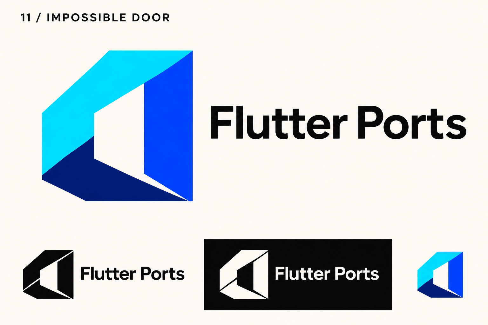
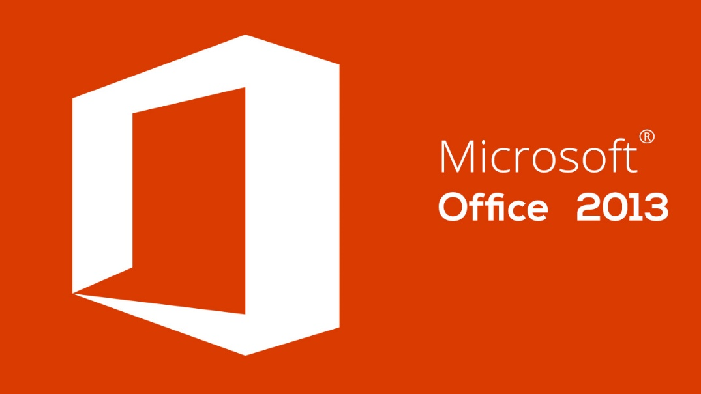

# 11-impossible-door — Impossible Door

[All concepts](../README.md) · [Full-size concept](concept.png) · [Original prompt](prompt.txt) · [Sources and hashes](references/sources.json)

**Visual assessment: Close structural resemblance.**

| Our generated concept | Existing work for comparison |
| --- | --- |
|  | **[Microsoft Office (2013-era)](https://www.wps.com/blog/how-to-install-and-use-microsoft-office-2013-on-linux-a-comprehensive-guide/)**   **[Autodesk ribbon identity (historical)](https://grupodeco.co/)**  |

## What is similar, and what differs

The hollow faceted doorway is close to Office's historical doorway family. Autodesk's historical folded A also shares broad folded colored planes. Our three-piece perimeter and cut differ, but the reference family is visibly similar.

## Actual generation provenance

Text-generated impossible-geometry brief. The prompt explicitly asked to avoid Office-like shapes; the result still resembles that family.

An existing brand named in a negative prompt (for example, “do not resemble …”) is an exclusion, not evidence that its image was used.

## Search record

Reviewed 2026-11-02. Preliminary descriptive web/image search and direct visual comparison; not reverse-image search or proof of provenance.

Search queries used for this design or its family:

- Microsoft Office 2013 logo
- folded gate logo Autodesk

A missing close match means only that this bounded search did not establish one. It is not a uniqueness claim. Comparisons can be historical marks or shared design archetypes; refer to the source metadata for versions and attribution.
