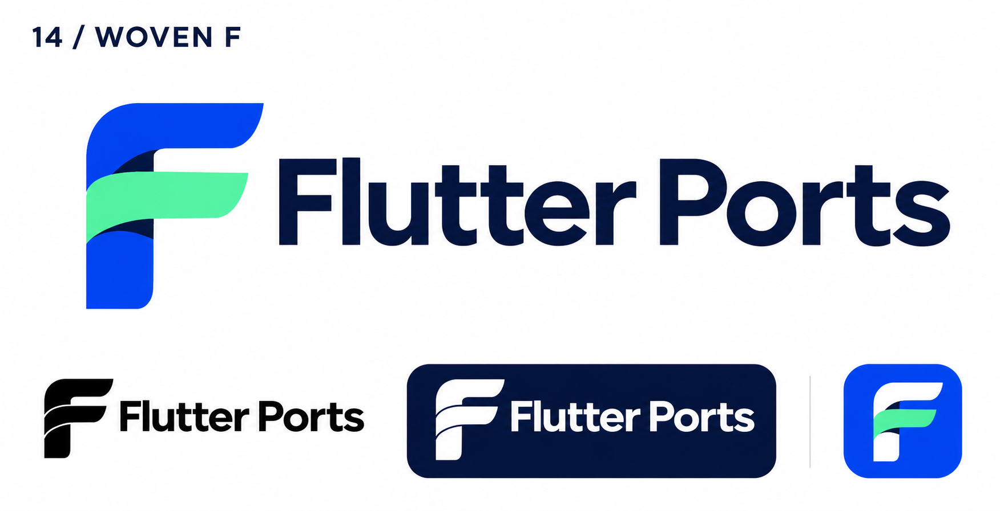
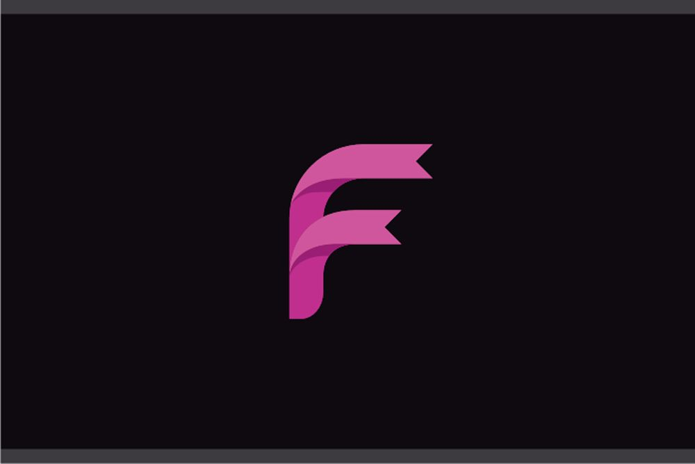

# 14-woven-f — Woven F

[All concepts](../README.md) · [Full-size concept](concept.png) · [Original prompt](prompt.txt) · [Sources and hashes](references/sources.json)

**Visual assessment: Close structural resemblance.**

| Our generated concept | Existing work for comparison |
| --- | --- |
|  | **[Flexible Letter F Ribbon — stock design](https://www.codester.com/items/58232/flexible-letter-f-ribbon-logo-design-vector)**  |

## What is similar, and what differs

Both form F from broad curled ribbon strips with layered gaps. The stock mark is slimmer, magenta and more pointed; ours has rounder terminals, a straighter base and a green middle arm. The ribbon-F construction itself is notably close.

## Actual generation provenance

Text-generated woven-F brief. This stock design was not a generation input.

An existing brand named in a negative prompt (for example, “do not resemble …”) is an exclusion, not evidence that its image was used.

## Search record

Reviewed 2026-11-02. Preliminary descriptive web/image search and direct visual comparison; not reverse-image search or proof of provenance.

Search queries used for this design or its family:

- ribbon letter F logo flow

A missing close match means only that this bounded search did not establish one. It is not a uniqueness claim. Comparisons can be historical marks or shared design archetypes; refer to the source metadata for versions and attribution.
