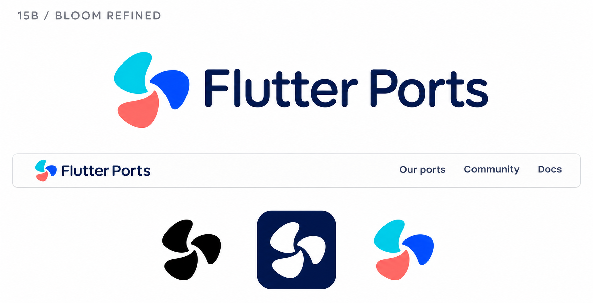

# 15b-bloom-refined — Bloom Refined

[All concepts](../README.md) · [Full-size concept](concept.png) · [Original prompt](prompt.txt) · [Sources and hashes](references/sources.json)

**Visual assessment: Related three-part organic motif.**

| Our generated concept | Existing work for comparison |
| --- | --- |
|  | **[CJ Blossom](https://www.cj.net/kr/en/cj-introduction)**   **[Youth of Peel](https://youthofpeel.ca/)**  |

## What is similar, and what differs

Refining 15 preserves the same resemblance to CJ's separate petals and Youth of Peel's rotating segments. Shape, gaps and color differ from both. No exact match was established.

## Actual generation provenance

Refinement using our concept 15 as the sole image reference.

Earlier concept inputs:

- [15-kinetic-bloom](references/input-15-kinetic-bloom.png)

An existing brand named in a negative prompt (for example, “do not resemble …”) is an exclusion, not evidence that its image was used.

## Search record

Reviewed 2026-11-02. Preliminary descriptive web/image search and direct visual comparison; not reverse-image search or proof of provenance.

Search queries used for this design or its family:

- three petal pinwheel logo cyan blue coral

A missing close match means only that this bounded search did not establish one. It is not a uniqueness claim. Comparisons can be historical marks or shared design archetypes; refer to the source metadata for versions and attribution.
