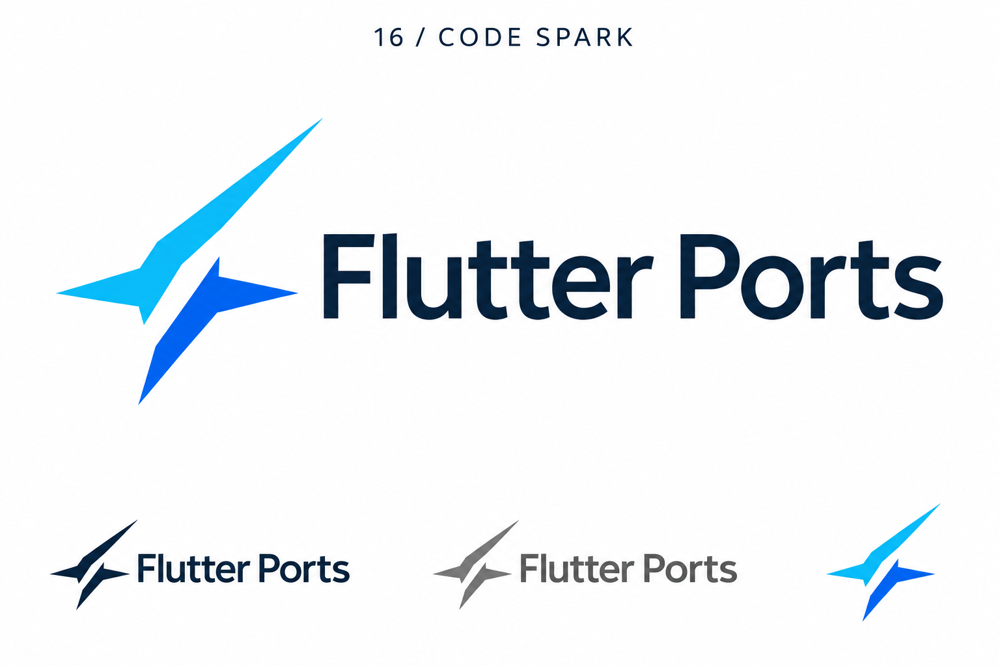
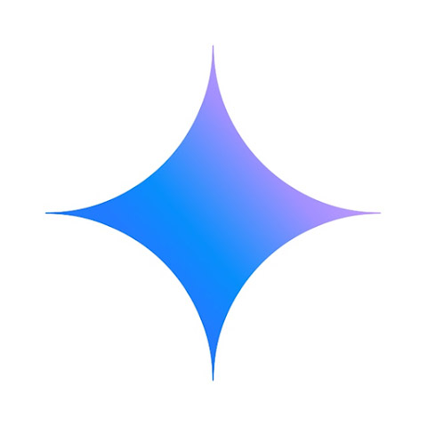

# 16-code-spark — Code Spark

[All concepts](../README.md) · [Full-size concept](concept.png) · [Original prompt](prompt.txt) · [Sources and hashes](references/sources.json)

**Visual assessment: Related spark category.**

| Our generated concept | Existing work for comparison |
| --- | --- |
|  | **[Gemini spark (blue/purple version)](https://k-tai.watch.impress.co.jp/docs/column/teppan/1641536.html)**  |

## What is similar, and what differs

Both have a four-point spark concept and blue color. Gemini is a single smooth symmetric concave star; ours splits into two angular diagonal strokes with strongly unequal points. The category is common; this is not an exact silhouette match.

## Actual generation provenance

Text-generated asymmetric code-spark brief. Gemini was not supplied as an input.

An existing brand named in a negative prompt (for example, “do not resemble …”) is an exclusion, not evidence that its image was used.

## Search record

Reviewed 2026-11-02. Preliminary descriptive web/image search and direct visual comparison; not reverse-image search or proof of provenance.

Search queries used for this design or its family:

- blue four point spark logo Gemini

A missing close match means only that this bounded search did not establish one. It is not a uniqueness claim. Comparisons can be historical marks or shared design archetypes; refer to the source metadata for versions and attribution.
