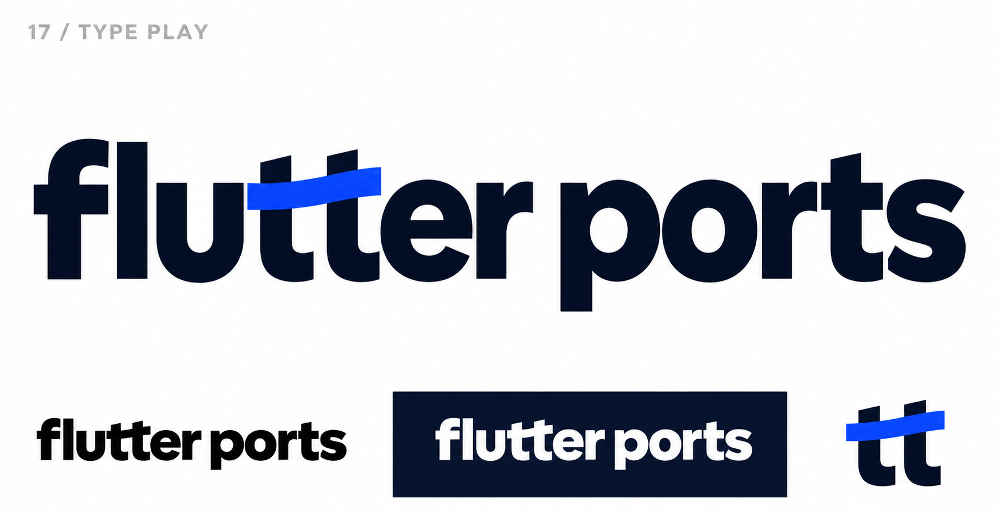
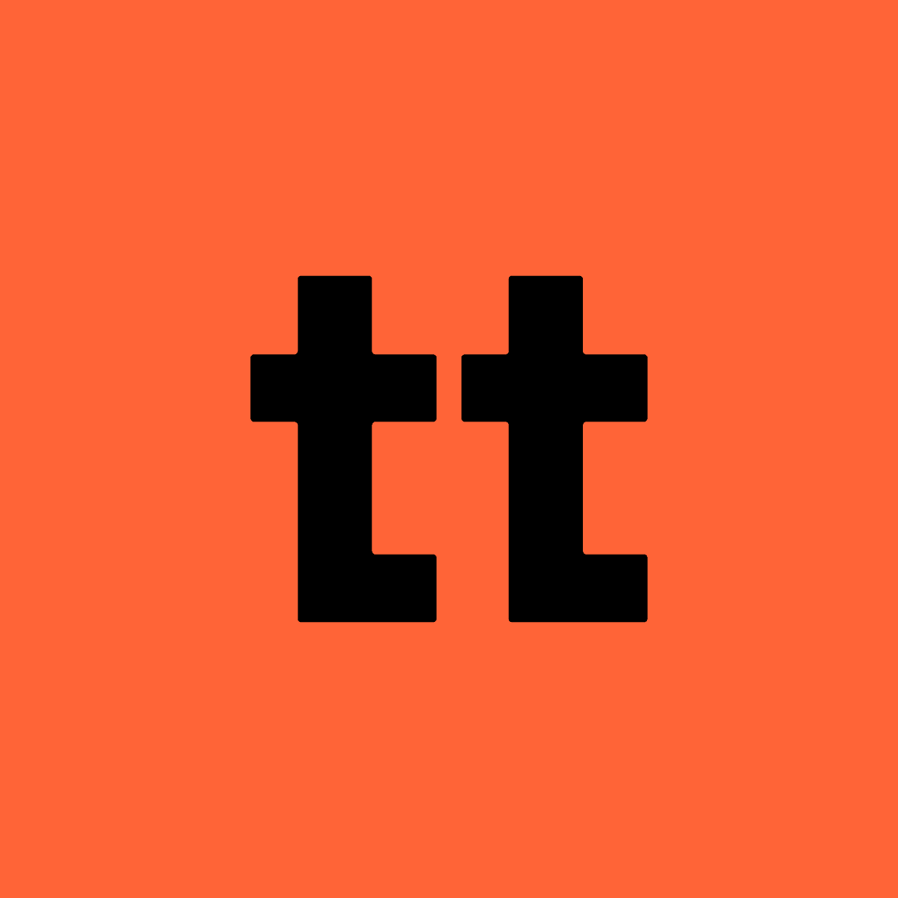
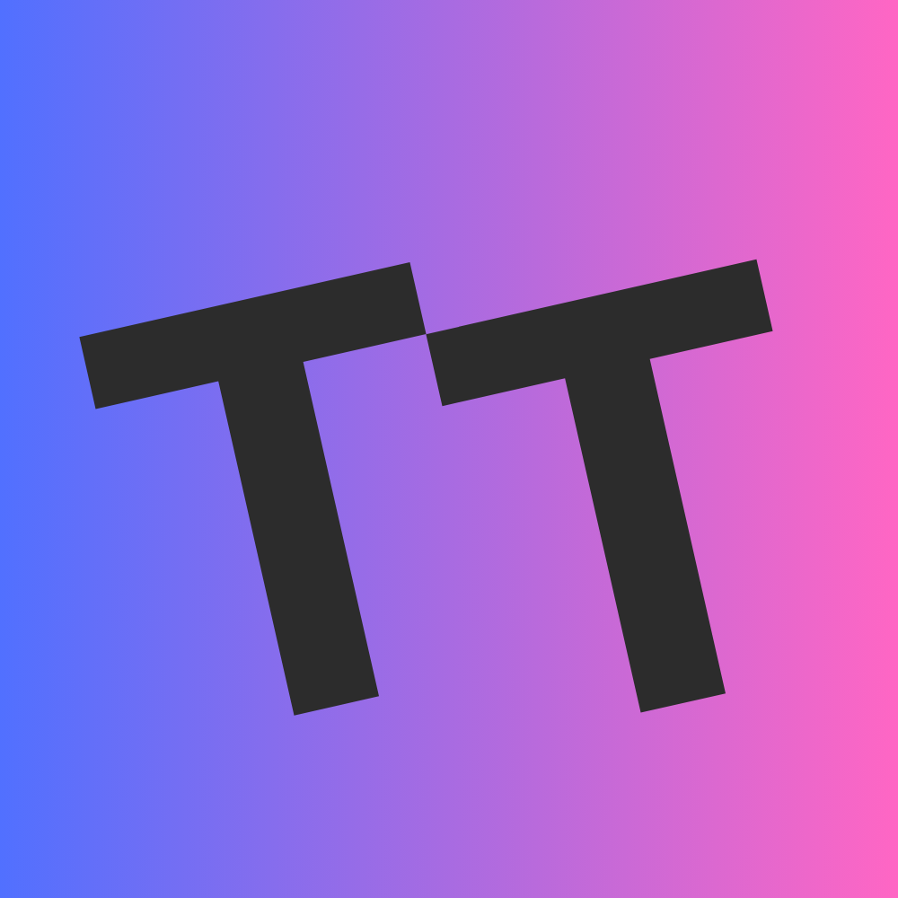

# 17-type-play — Type Play

[All concepts](../README.md) · [Full-size concept](concept.png) · [Original prompt](prompt.txt) · [Sources and hashes](references/sources.json)

**Visual assessment: Related TT motif.**

| Our generated concept | Existing work for comparison |
| --- | --- |
|  | **[TT Seoul](https://www.ttseoul.com/news)**   **[TaskTango](https://nordiclabs.dev/)**  |

## What is similar, and what differs

TT Seoul shares heavy lowercase tt with rightward feet; TaskTango shares a double-T diagonal arrangement. Ours joins a rising blue crossbar and integrates it inside the full flutter ports wordmark. The full wordmark is more differentiated than the standalone tt avatar.

## Actual generation provenance

Text-generated custom shared-tt-crossbar brief; no external logo image input.

An existing brand named in a negative prompt (for example, “do not resemble …”) is an exclusion, not evidence that its image was used.

## Search record

Reviewed 2026-11-02. Preliminary descriptive web/image search and direct visual comparison; not reverse-image search or proof of provenance.

Search queries used for this design or its family:

- TypeType logo tt
- tt logo joined t letters crossbar

A missing close match means only that this bounded search did not establish one. It is not a uniqueness claim. Comparisons can be historical marks or shared design archetypes; refer to the source metadata for versions and attribution.
