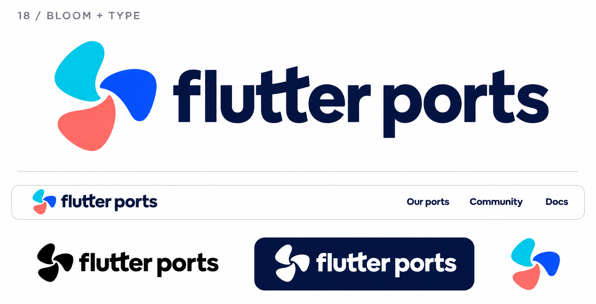

# 18-bloom-type — Bloom + Type

[All concepts](../README.md) · [Full-size concept](concept.png) · [Original prompt](prompt.txt) · [Sources and hashes](references/sources.json)

**Visual assessment: Combination of two related motifs.**

| Our generated concept | Existing work for comparison |
| --- | --- |
|  | **[CJ Blossom](https://www.cj.net/kr/en/cj-introduction)**   **[Youth of Peel](https://youthofpeel.ca/)**   **[TT Seoul](https://www.ttseoul.com/news)**   **[TaskTango](https://nordiclabs.dev/)**  |

## What is similar, and what differs

The symbol retains Bloom's three-part organic similarities; the wordmark retains Type Play's TT similarities. Combining them does not remove those relationships, though no exact combined lockup was found.

## Actual generation provenance

Generated from our concepts 15 and 17 as the two image references.

Earlier concept inputs:

- [15-kinetic-bloom](references/input-15-kinetic-bloom.png)
- [17-type-play](references/input-17-type-play.png)

An existing brand named in a negative prompt (for example, “do not resemble …”) is an exclusion, not evidence that its image was used.

## Search record

Reviewed 2026-11-02. Preliminary descriptive web/image search and direct visual comparison; not reverse-image search or proof of provenance.

Search queries used for this design or its family:

- three petal pinwheel logo cyan blue coral
- TypeType logo tt

A missing close match means only that this bounded search did not establish one. It is not a uniqueness claim. Comparisons can be historical marks or shared design archetypes; refer to the source metadata for versions and attribution.
