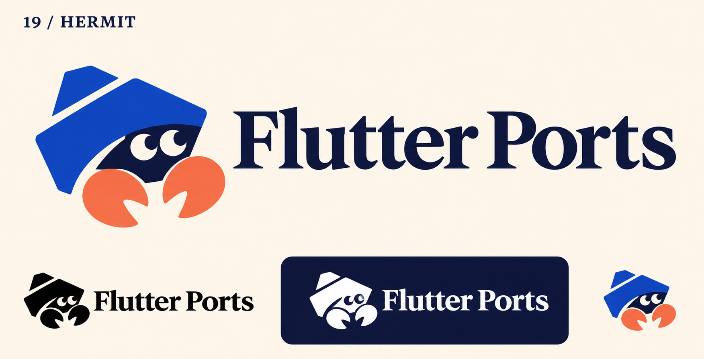
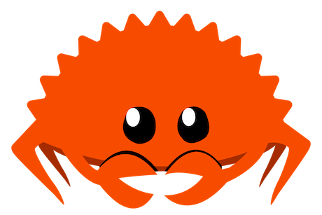

# 19-hermit — Hermit

[All concepts](../README.md) · [Full-size concept](concept.png) · [Original prompt](prompt.txt) · [Sources and hashes](references/sources.json)

**Visual assessment: Shared mascot theme, different construction.**

| Our generated concept | Existing work for comparison |
| --- | --- |
|  | **[Ferris the Rustacean](https://rustacean.net/)**  |

## What is similar, and what differs

Both are friendly crab-like developer mascots with two eyes and prominent claws. Ferris is a bright orange spiky crab with thin legs; ours is a shelled hermit with a blue angular upper body and orange claws. The species/theme overlap is stronger than the contour resemblance.

## Actual generation provenance

Text-generated hermit-crab brief. Ferris was not supplied as an input.

An existing brand named in a negative prompt (for example, “do not resemble …”) is an exclusion, not evidence that its image was used.

## Search record

Reviewed 2026-11-02. Preliminary descriptive web/image search and direct visual comparison; not reverse-image search or proof of provenance.

Search queries used for this design or its family:

- Rust Ferris mascot official
- Rustacean Ferris rustacean.net

A missing close match means only that this bounded search did not establish one. It is not a uniqueness claim. Comparisons can be historical marks or shared design archetypes; refer to the source metadata for versions and attribution.
