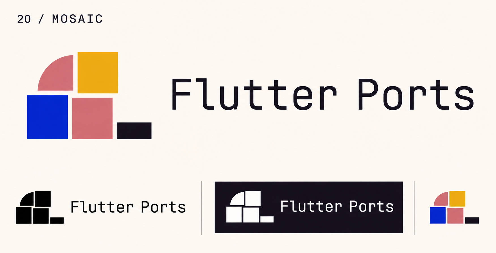

# 20-mosaic — Mosaic

[All concepts](../README.md) · [Full-size concept](concept.png) · [Original prompt](prompt.txt) · [Sources and hashes](references/sources.json)

**Visual assessment: Related modular motif; no close match found.**

| Our generated concept | Existing work for comparison |
| --- | --- |
|  | **[LEMITO modular mark](https://www.lemito.cz/)**  |

## What is similar, and what differs

Both assemble colored tiles into a stepped block. LEMITO uses many rounded cyan/blue squares; ours uses five unequal tiles including a quarter-circle, in several colors. This is a common modular vocabulary, not an exact match. MosaicML was inspected and rejected as a close comparator.

## Actual generation provenance

Text-generated five-tile modular identity brief; no external image input.

An existing brand named in a negative prompt (for example, “do not resemble …”) is an exclusion, not evidence that its image was used.

## Search record

Reviewed 2026-11-02. Preliminary descriptive web/image search and direct visual comparison; not reverse-image search or proof of provenance.

Search queries used for this design or its family:

- geometric modular mosaic logo squares
- MosaicML logo

A missing close match means only that this bounded search did not establish one. It is not a uniqueness claim. Comparisons can be historical marks or shared design archetypes; refer to the source metadata for versions and attribution.
