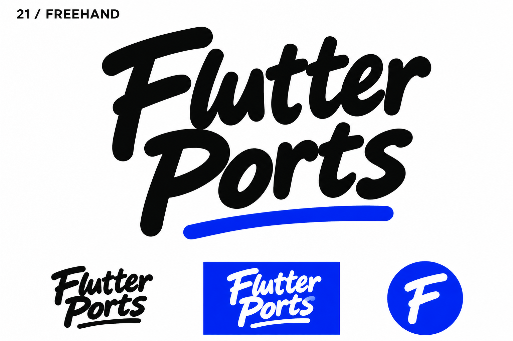
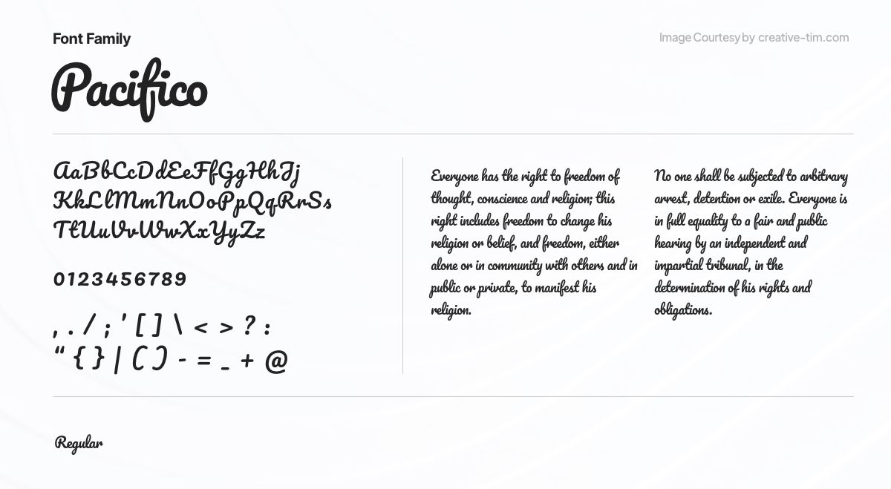

# 21-freehand — Freehand

[All concepts](../README.md) · [Full-size concept](concept.png) · [Original prompt](prompt.txt) · [Sources and hashes](references/sources.json)

**Visual assessment: Typeface-family comparison, not a matched logo.**

| Our generated concept | Existing work for comparison |
| --- | --- |
|  | **[Pacifico type specimen (not a logo)](https://www.creative-tim.com/blog/educational-ui-ux/best-free-fonts-for-websites-the-ultimate-collection/)**  |

## What is similar, and what differs

Pacifico demonstrates a pre-existing rounded connected brush-script style. Ours differs in individual letters, stacking and underline. This does not identify the generated lettering as Pacifico; it shows that the broad lettering idiom is familiar. No close branded lockup was found.

## Actual generation provenance

Text-generated handwritten-wordmark brief. No font file or external specimen was supplied during generation.

An existing brand named in a negative prompt (for example, “do not resemble …”) is an exclusion, not evidence that its image was used.

## Search record

Reviewed 2026-11-02. Preliminary descriptive web/image search and direct visual comparison; not reverse-image search or proof of provenance.

Search queries used for this design or its family:

- Pacifico font specimen

A missing close match means only that this bounded search did not establish one. It is not a uniqueness claim. Comparisons can be historical marks or shared design archetypes; refer to the source metadata for versions and attribution.
