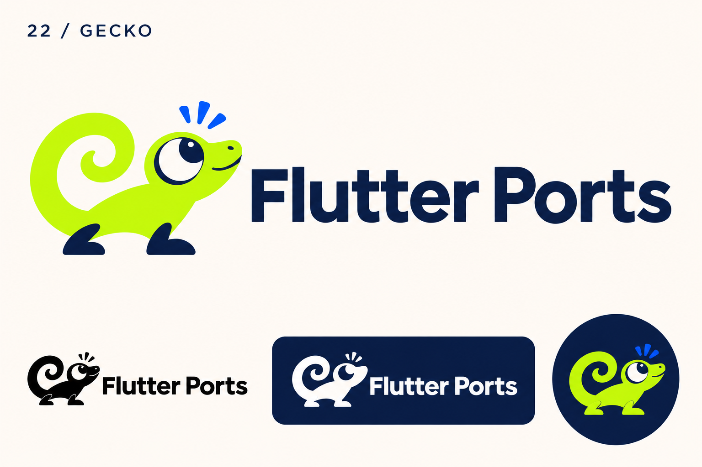
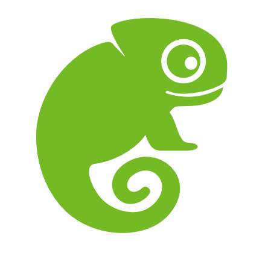

# 22-gecko — Gecko

[All concepts](../README.md) · [Full-size concept](concept.png) · [Original prompt](prompt.txt) · [Sources and hashes](references/sources.json)

**Visual assessment: Strong thematic and silhouette resemblance.**

| Our generated concept | Existing work for comparison |
| --- | --- |
|  | **[openSUSE Geeko](https://github.com/openSUSE/branding/issues/93)**  |

## What is similar, and what differs

Both use a bright green side-profile reptile with a large eye and tightly curled tail in an open-source identity. Our full body, feet and expression differ, while Geeko is a more compact circular silhouette. This deserves particular review because of both mascot choice and software context.

## Actual generation provenance

Text-generated gecko brief. openSUSE's Geeko was not supplied as an image reference.

An existing brand named in a negative prompt (for example, “do not resemble …”) is an exclusion, not evidence that its image was used.

## Search record

Reviewed 2026-11-02. Preliminary descriptive web/image search and direct visual comparison; not reverse-image search or proof of provenance.

Search queries used for this design or its family:

- SUSE Geeko logo

A missing close match means only that this bounded search did not establish one. It is not a uniqueness claim. Comparisons can be historical marks or shared design archetypes; refer to the source metadata for versions and attribution.
