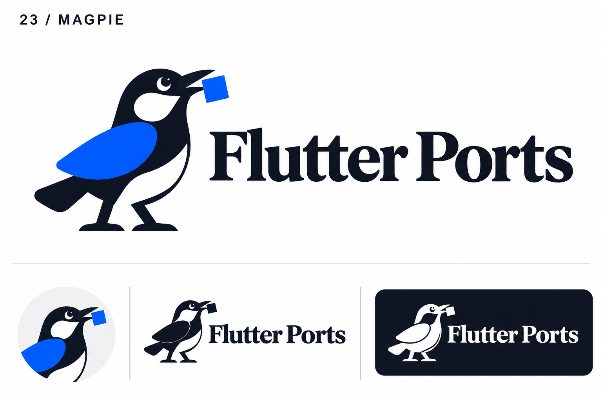
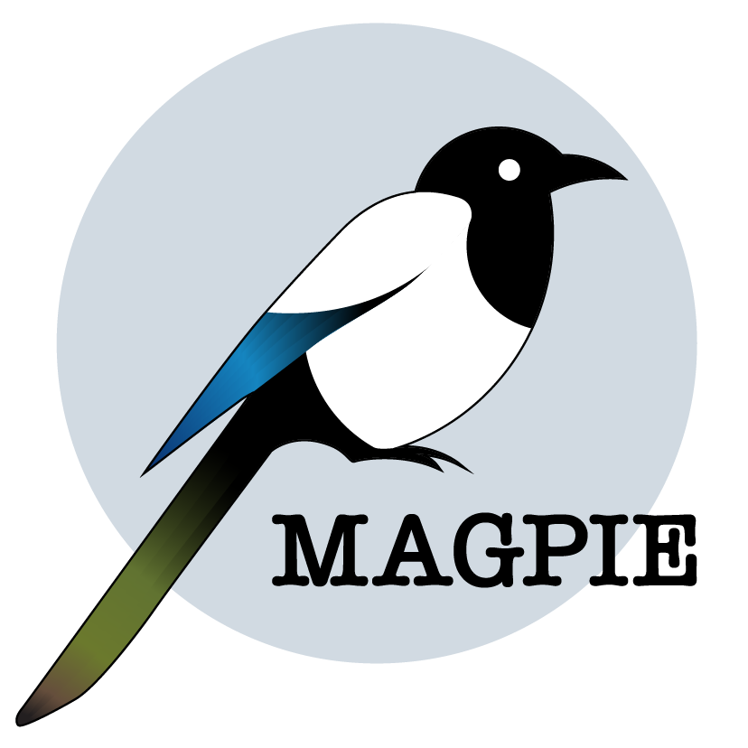

# 23-magpie — Magpie

[All concepts](../README.md) · [Full-size concept](concept.png) · [Original prompt](prompt.txt) · [Sources and hashes](references/sources.json)

**Visual assessment: Shared mascot species and software context.**

| Our generated concept | Existing work for comparison |
| --- | --- |
|  | **[MAGPIE Pipeline mascot](https://core-bioinformatics.github.io/magpie/intro.html)**  |

## What is similar, and what differs

Both are black/white magpies with a blue wing. The pipeline reference has a long multicolor tail and no carried object; ours has a short tail, upright stance and square in its beak. These are natural magpie markings plus a shared mascot choice, not an exact drawing.

## Actual generation provenance

Text-generated magpie-collecting-a-square brief; no external image input.

An existing brand named in a negative prompt (for example, “do not resemble …”) is an exclusion, not evidence that its image was used.

## Search record

Reviewed 2026-11-02. Preliminary descriptive web/image search and direct visual comparison; not reverse-image search or proof of provenance.

Search queries used for this design or its family:

- Magpie software logo bird

A missing close match means only that this bounded search did not establish one. It is not a uniqueness claim. Comparisons can be historical marks or shared design archetypes; refer to the source metadata for versions and attribution.
