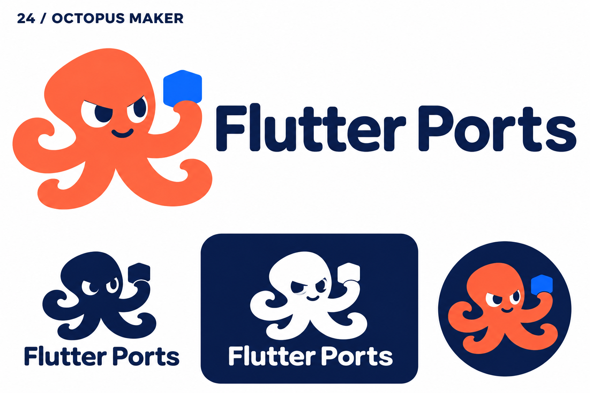
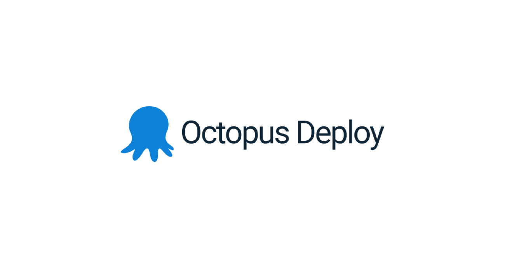

# 24-octopus — Octopus Maker

[All concepts](../README.md) · [Full-size concept](concept.png) · [Original prompt](prompt.txt) · [Sources and hashes](references/sources.json)

**Visual assessment: Shared software mascot category.**

| Our generated concept | Existing work for comparison |
| --- | --- |
|  | **[Octopus Deploy](https://octopus.com/company/brand)**  |

## What is similar, and what differs

Octopus Deploy uses a simple blue octopus silhouette. Ours is orange with a tilted head, expressive face and a held block. The animal and developer-tool context overlap, but the specific character geometry differs. No exact character match was found.

## Actual generation provenance

Text-generated octopus-maker brief. The prompt mentioned avoiding GitHub's cat hybrid; Octopus Deploy was not supplied.

An existing brand named in a negative prompt (for example, “do not resemble …”) is an exclusion, not evidence that its image was used.

## Search record

Reviewed 2026-11-02. Preliminary descriptive web/image search and direct visual comparison; not reverse-image search or proof of provenance.

Search queries used for this design or its family:

- Octopus Deploy logo official

A missing close match means only that this bounded search did not establish one. It is not a uniqueness claim. Comparisons can be historical marks or shared design archetypes; refer to the source metadata for versions and attribution.
