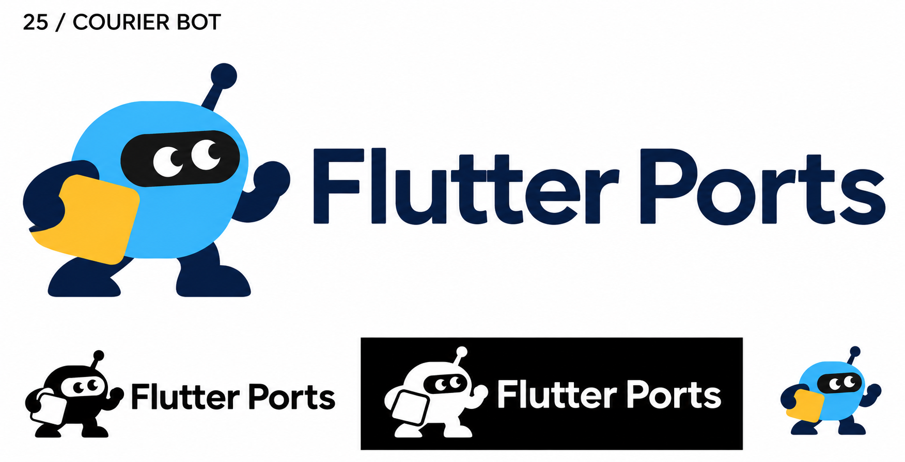
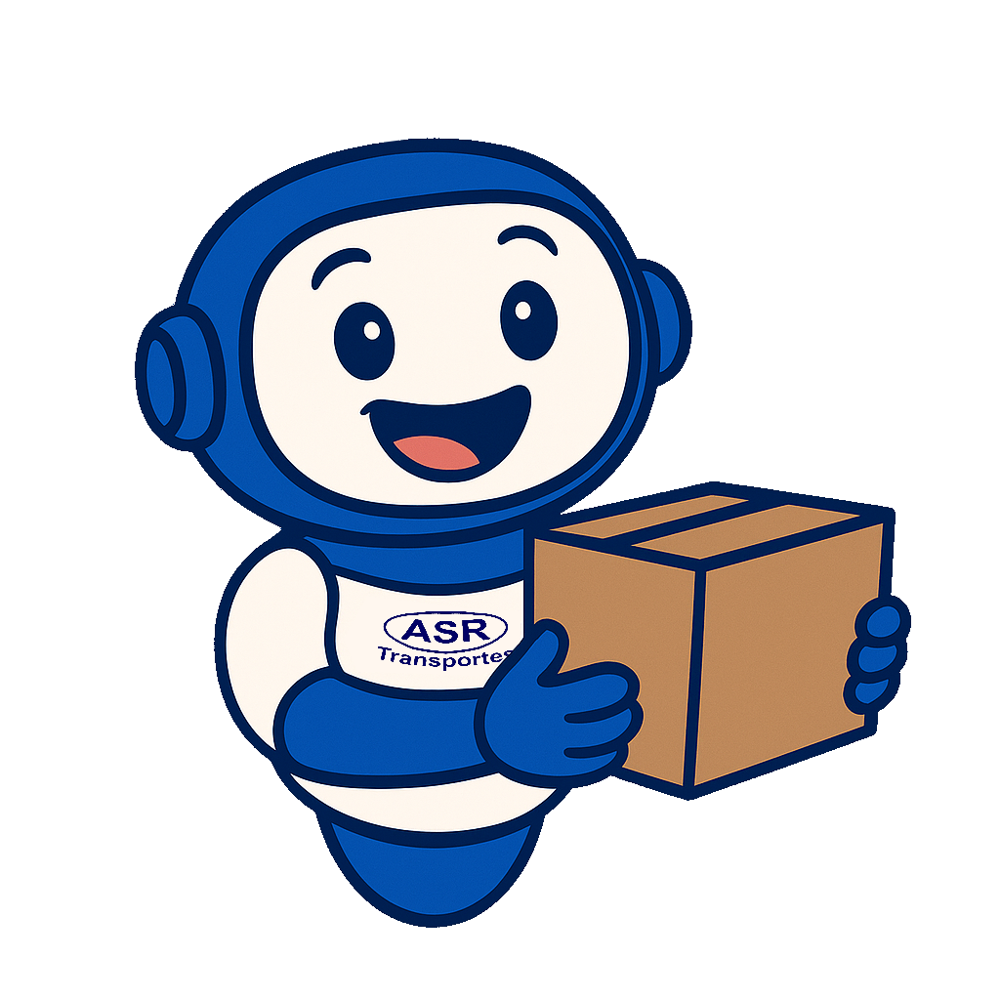

# 25-courier-bot — Courier Bot

[All concepts](../README.md) · [Full-size concept](concept.png) · [Original prompt](prompt.txt) · [Sources and hashes](references/sources.json)

**Visual assessment: Shared delivery-character theme.**

| Our generated concept | Existing work for comparison |
| --- | --- |
|  | **[ASR Transportes delivery mascot](https://www.asrtransportes.com.br/cidades_atendidas)**  |

## What is similar, and what differs

ASR's mascot is a smiling helmeted delivery character holding a parcel; ours is a short robot with a face window and yellow parcel. The reference is thematically related, not a close silhouette match. Do not treat the search's robot description as proof that the ASR character is a robot.

## Actual generation provenance

Text-generated delivery-robot brief; no external image input.

An existing brand named in a negative prompt (for example, “do not resemble …”) is an exclusion, not evidence that its image was used.

## Search record

Reviewed 2026-11-02. Preliminary descriptive web/image search and direct visual comparison; not reverse-image search or proof of provenance.

Search queries used for this design or its family:

- friendly delivery robot mascot logo

A missing close match means only that this bounded search did not establish one. It is not a uniqueness claim. Comparisons can be historical marks or shared design archetypes; refer to the source metadata for versions and attribution.
