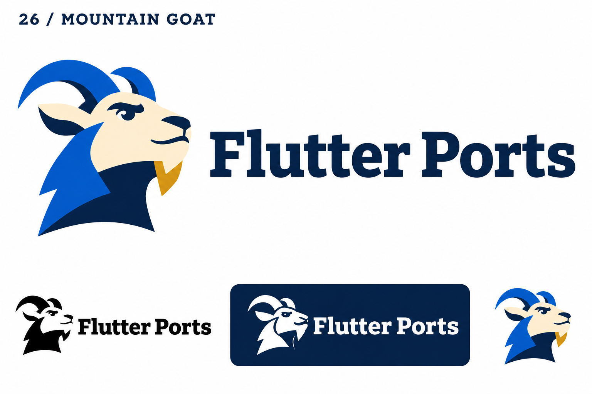
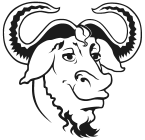

# 26-mountain-goat — Mountain Goat

[All concepts](../README.md) · [Full-size concept](concept.png) · [Original prompt](prompt.txt) · [Sources and hashes](references/sources.json)

**Visual assessment: Shared horned software mascot theme.**

| Our generated concept | Existing work for comparison |
| --- | --- |
|  | **[GNU head](https://www.gnu.org/graphics/heckert_gnu.html)**  |

## What is similar, and what differs

GNU's gnu head and our goat both have prominent horns and a beard in a software context. GNU uses a line-drawn frontal head with curled horns; ours has a colored side profile and swept-back horns. Different animals and drawings; no exact match found.

## Actual generation provenance

Text-generated mountain-goat brief. GNU was not supplied as an image reference.

An existing brand named in a negative prompt (for example, “do not resemble …”) is an exclusion, not evidence that its image was used.

## Search record

Reviewed 2026-11-02. Preliminary descriptive web/image search and direct visual comparison; not reverse-image search or proof of provenance.

Search queries used for this design or its family:

- GNU goat logo official

A missing close match means only that this bounded search did not establish one. It is not a uniqueness claim. Comparisons can be historical marks or shared design archetypes; refer to the source metadata for versions and attribution.
