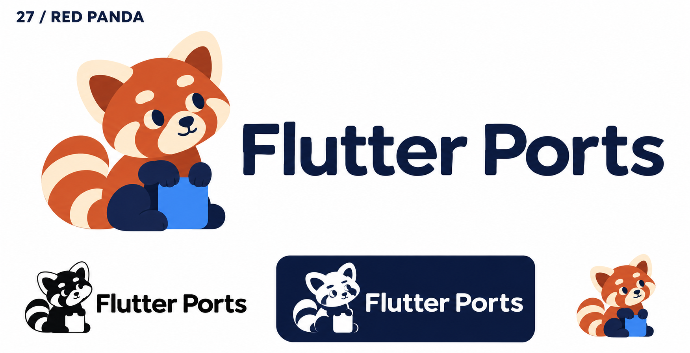
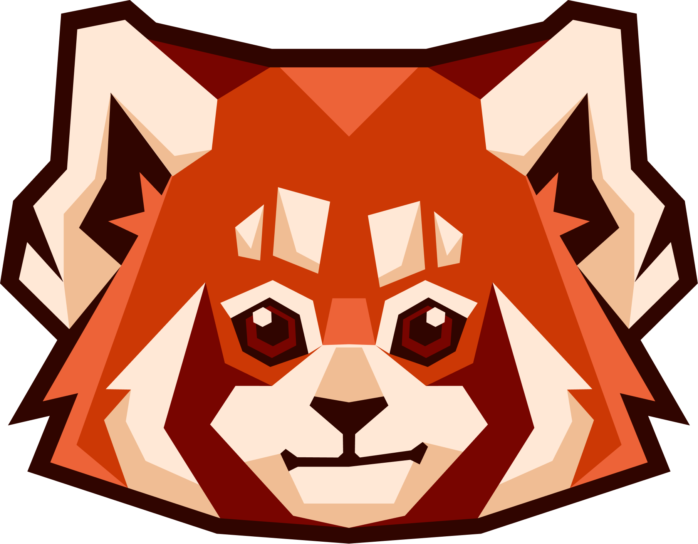

# 27-red-panda — Red Panda

[All concepts](../README.md) · [Full-size concept](concept.png) · [Original prompt](prompt.txt) · [Sources and hashes](references/sources.json)

**Visual assessment: Shared species and coloring, different drawing.**

| Our generated concept | Existing work for comparison |
| --- | --- |
|  | **[Redpanda Data mascot](https://medium.com/@redpanda-data/about)**  |

## What is similar, and what differs

Redpanda Data's face has angular facets and sharp eyes. Ours is a rounded seated full-body character with striped tail and blue square. Natural orange/cream markings and developer context overlap; the geometry and composition differ.

## Actual generation provenance

Text-generated red-panda brief. Firefox was mentioned only as something to avoid; Redpanda Data was not an input.

An existing brand named in a negative prompt (for example, “do not resemble …”) is an exclusion, not evidence that its image was used.

## Search record

Reviewed 2026-11-02. Preliminary descriptive web/image search and direct visual comparison; not reverse-image search or proof of provenance.

Search queries used for this design or its family:

- Redpanda data mascot logo

A missing close match means only that this bounded search did not establish one. It is not a uniqueness claim. Comparisons can be historical marks or shared design archetypes; refer to the source metadata for versions and attribution.
