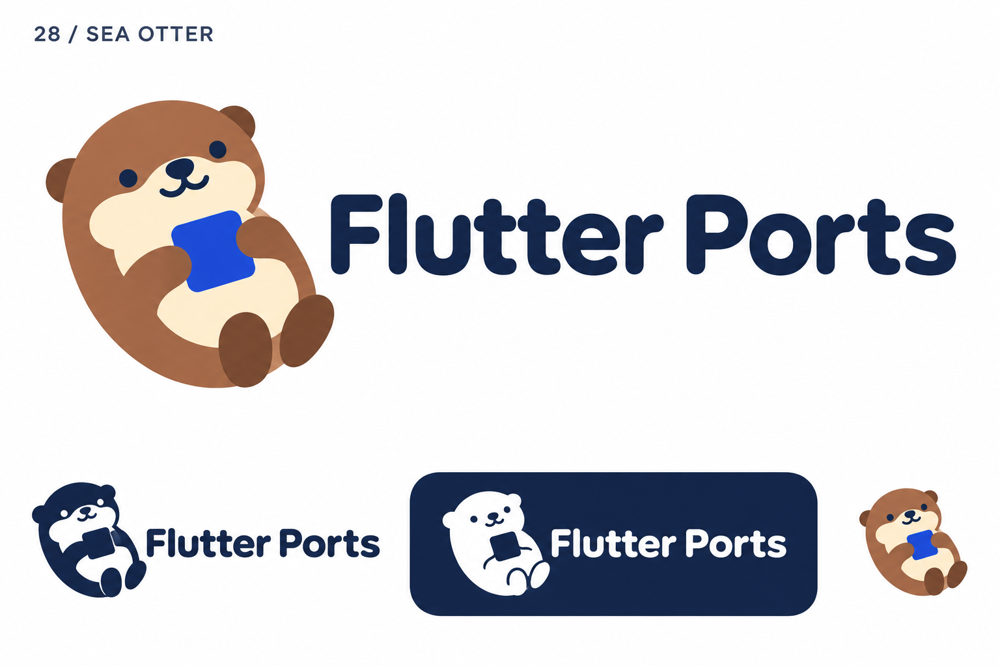
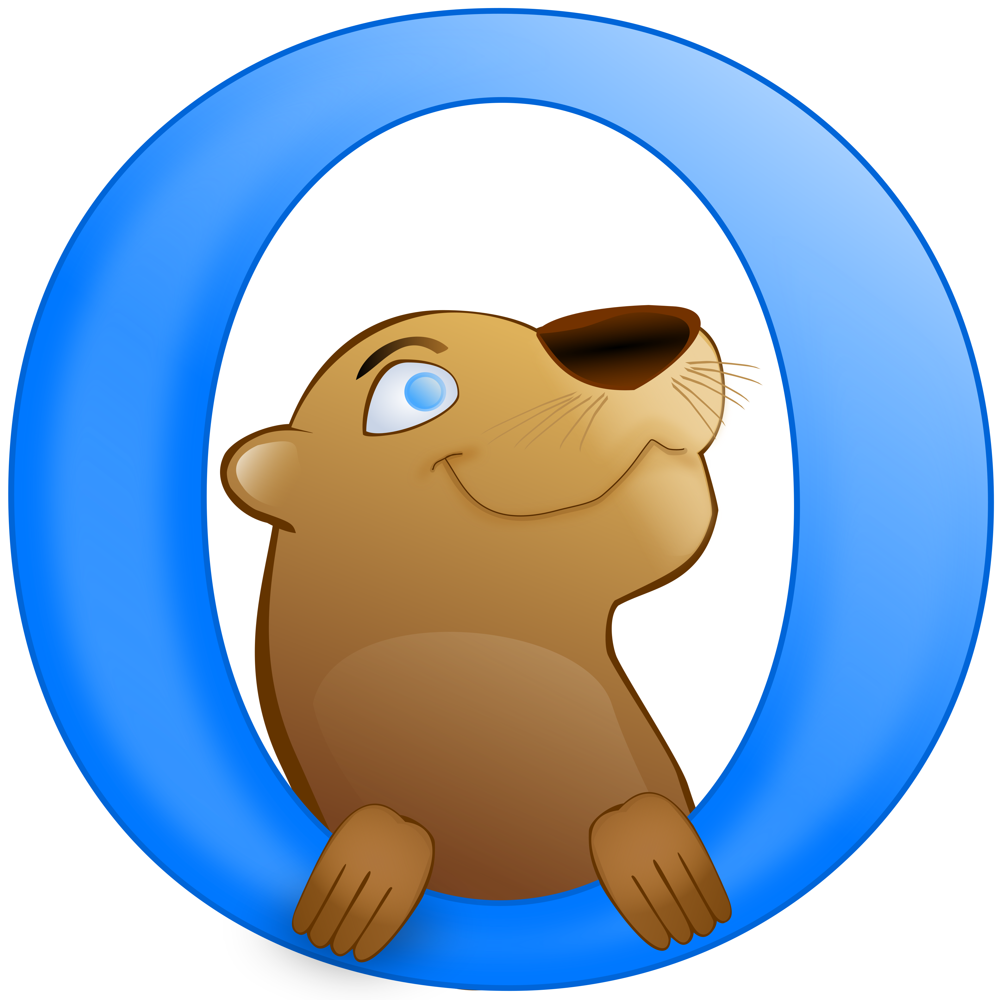

# 28-sea-otter — Sea Otter

[All concepts](../README.md) · [Full-size concept](concept.png) · [Original prompt](prompt.txt) · [Sources and hashes](references/sources.json)

**Visual assessment: Shared mascot species and palette.**

| Our generated concept | Existing work for comparison |
| --- | --- |
|  | **[Otter Browser](https://commons.wikimedia.org/wiki/File:Otter_Browser_Logo.svg)**  |

## What is similar, and what differs

Otter Browser uses a brown otter peeking through a blue ring; ours reclines with a square on its tummy and no ring. The same animal, brown/cream coloring and blue accent are common ground, but pose and composition differ.

## Actual generation provenance

Text-generated reclining sea-otter brief; no external image input.

An existing brand named in a negative prompt (for example, “do not resemble …”) is an exclusion, not evidence that its image was used.

## Search record

Reviewed 2026-11-02. Preliminary descriptive web/image search and direct visual comparison; not reverse-image search or proof of provenance.

Search queries used for this design or its family:

- Otter Browser logo

A missing close match means only that this bounded search did not establish one. It is not a uniqueness claim. Comparisons can be historical marks or shared design archetypes; refer to the source metadata for versions and attribution.
