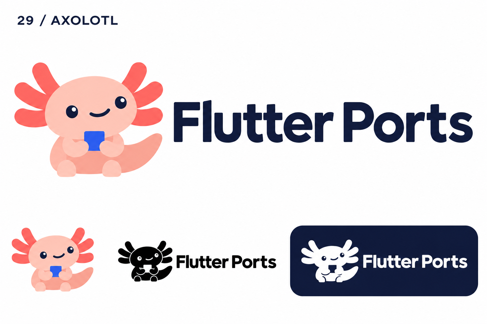
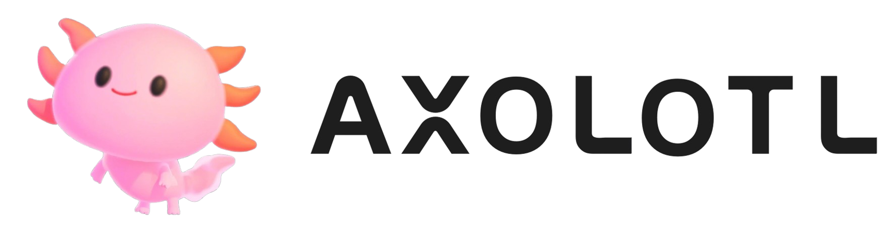
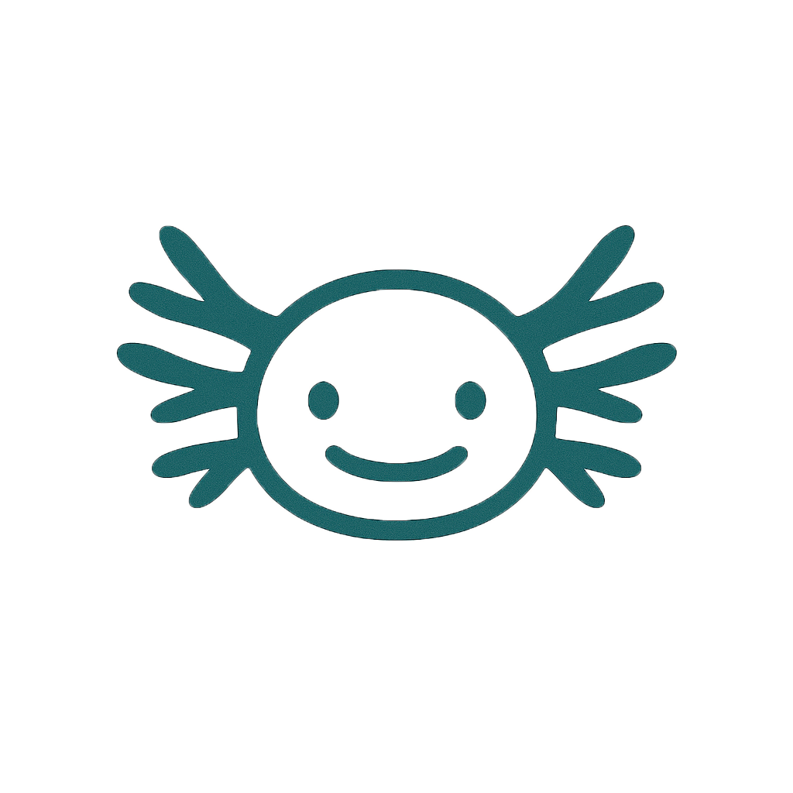

# 29-axolotl — Axolotl

[All concepts](../README.md) · [Full-size concept](concept.png) · [Original prompt](prompt.txt) · [Sources and hashes](references/sources.json)

**Visual assessment: Related mascot structure.**

| Our generated concept | Existing work for comparison |
| --- | --- |
|  | **[Axolotl Health](https://kr.axolotlhealth.com/)**   **[Estuary AI](https://www.estuary-ai.com/pricing/)**  |

## What is similar, and what differs

Axolotl Health has a pink smiling external-gill character; Estuary uses a teal outline face with side gills and a smile. Ours combines a full body, six broad gill branches and a blue square. These are close animal-character conventions, not evidence of the same asset.

## Actual generation provenance

Text-generated axolotl brief; neither outside mascot was an input.

An existing brand named in a negative prompt (for example, “do not resemble …”) is an exclusion, not evidence that its image was used.

## Search record

Reviewed 2026-11-02. Preliminary descriptive web/image search and direct visual comparison; not reverse-image search or proof of provenance.

Search queries used for this design or its family:

- Axolotl AI logo mascot

A missing close match means only that this bounded search did not establish one. It is not a uniqueness claim. Comparisons can be historical marks or shared design archetypes; refer to the source metadata for versions and attribution.
