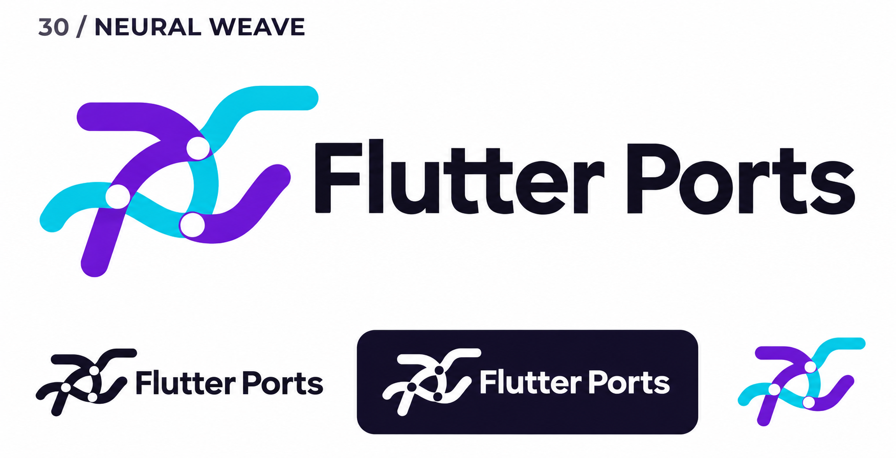
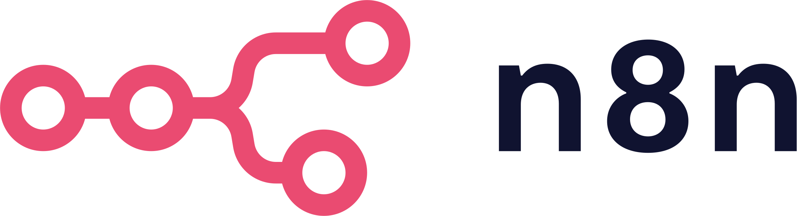

# 30-neural-weave — Neural Weave

[All concepts](../README.md) · [Full-size concept](concept.png) · [Original prompt](prompt.txt) · [Sources and hashes](references/sources.json)

**Visual assessment: Related node-and-path vocabulary.**

| Our generated concept | Existing work for comparison |
| --- | --- |
|  | **[n8n](https://orium.com/partners)**  |

## What is similar, and what differs

n8n uses linked round nodes on branching paths. Ours uses crossing curved paths with three circular cutouts and a different overall silhouette. Both communicate connected computation, but this is a visual-family comparison rather than a close match.

## Actual generation provenance

Text-generated AI-connections brief; known AI marks were mentioned as exclusions, not image inputs.

An existing brand named in a negative prompt (for example, “do not resemble …”) is an exclusion, not evidence that its image was used.

## Search record

Reviewed 2026-11-02. Preliminary descriptive web/image search and direct visual comparison; not reverse-image search or proof of provenance.

Search queries used for this design or its family:

- Weaviate logo neural
- n8n logo official

A missing close match means only that this bounded search did not establish one. It is not a uniqueness claim. Comparisons can be historical marks or shared design archetypes; refer to the source metadata for versions and attribution.
