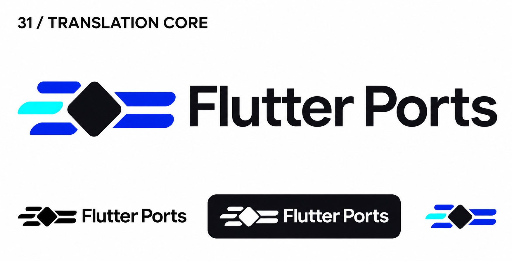
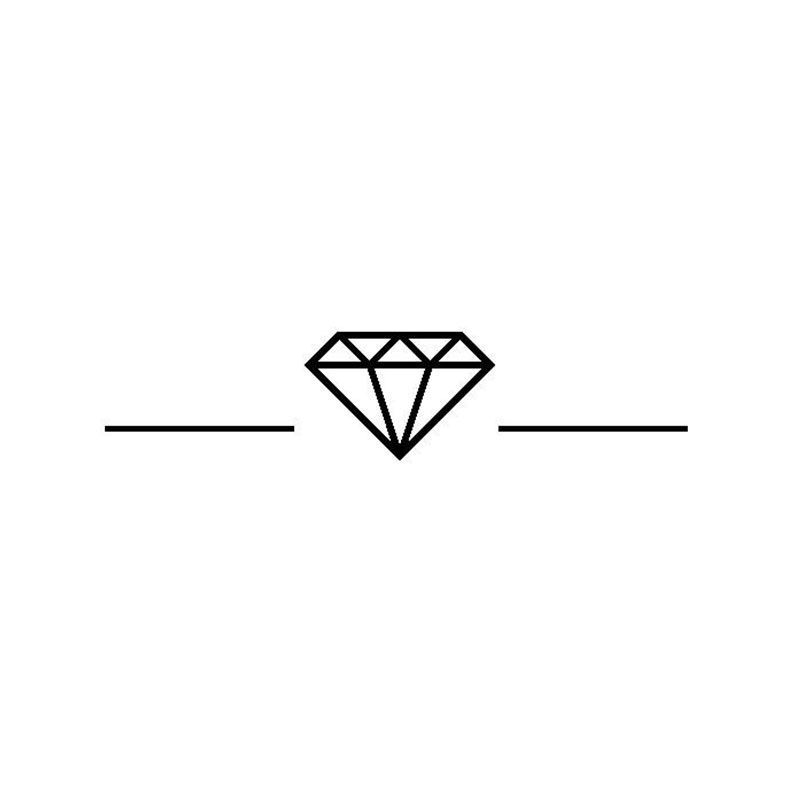

# 31-translation-core — Translation Core

[All concepts](../README.md) · [Full-size concept](concept.png) · [Original prompt](prompt.txt) · [Sources and hashes](references/sources.json)

**Visual assessment: Shared geometric device; no close brand match found.**

| Our generated concept | Existing work for comparison |
| --- | --- |
|  | **[Gysels diamond-and-lines emblem](https://www.gysels.be/over-ons)**  |

## What is similar, and what differs

Gysels places a diamond between horizontal lines. Ours uses a filled diamond/chip with staggered input/output bars. Shared central-diamond-and-lines construction, otherwise different. Apache Beam was inspected for dataflow imagery but rejected as a close mark.

## Actual generation provenance

Text-generated input-chip-output brief; no external image input.

An existing brand named in a negative prompt (for example, “do not resemble …”) is an exclusion, not evidence that its image was used.

## Search record

Reviewed 2026-11-02. Preliminary descriptive web/image search and direct visual comparison; not reverse-image search or proof of provenance.

Search queries used for this design or its family:

- diamond microchip logo horizontal lines
- Apache Beam logo
- Cerebras logo

A missing close match means only that this bounded search did not establish one. It is not a uniqueness claim. Comparisons can be historical marks or shared design archetypes; refer to the source metadata for versions and attribution.
