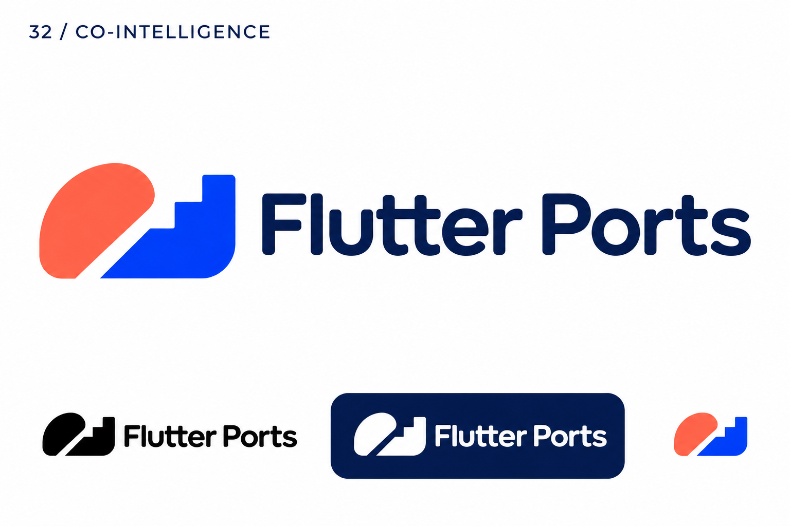

# 32-co-intelligence — Co-Intelligence

[All concepts](../README.md) · [Full-size concept](concept.png) · [Original prompt](prompt.txt) · [Sources and hashes](references/sources.json)

**Visual assessment: Related abstract AI-brand vocabulary.**

| Our generated concept | Existing work for comparison |
| --- | --- |
|  | **[Cohere](https://aws.amazon.com/ec2/instance-types/p5/)**  |

## What is similar, and what differs

Cohere combines rounded organic blobs in green, purple and coral. Ours combines one coral capsule and a cobalt stepped shape divided by a diagonal gap. Soft colored components and AI positioning overlap; the number, arrangement and contour differ.

## Actual generation provenance

Text-generated human/machine abstract-pair brief; Cohere was not supplied as a reference.

An existing brand named in a negative prompt (for example, “do not resemble …”) is an exclusion, not evidence that its image was used.

## Search record

Reviewed 2026-11-02. Preliminary descriptive web/image search and direct visual comparison; not reverse-image search or proof of provenance.

Search queries used for this design or its family:

- Paddle logo software
- Cohere logo official

A missing close match means only that this bounded search did not establish one. It is not a uniqueness claim. Comparisons can be historical marks or shared design archetypes; refer to the source metadata for versions and attribution.
