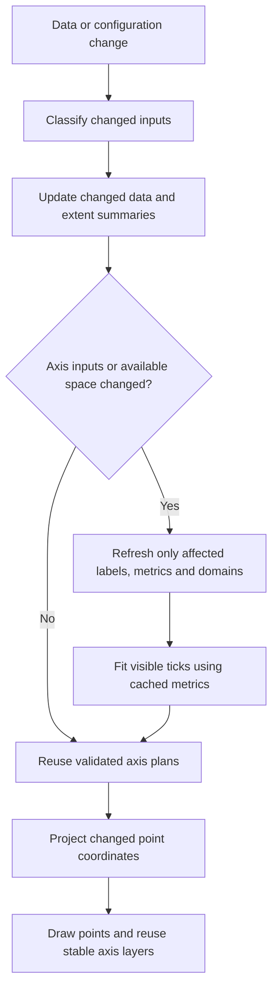

# Axis/update pipeline: options and measured ceilings

2026-11-02. Analysis and experimental builds only; this investigation changes no
production library or gallery configuration. The baseline includes both retained
optimizations in performance.md §27–28. The user reports 31–32 FPS with that code.

The follow-up [ADR 0064 implementation](adr/0064-axis-label-plan.md) caches
content measurements while retaining fresh ticks/contexts and live geometry.
Its actual measurements and limits are in performance.md §30; the prototype
ceilings below remain an investigation record.

## Conclusion

Warm axis/layout processing can plausibly be reduced below **1 ms per frame** for
this chart. Three measurements support that target:

- Existing configuration, `sampleSize: 100` plus known bounds: **0.686 ms layout**.
- Prototype reusing x-layout, with known bounds: **0.223 ms layout**.
- Prototype reusing the complete layout: no layout execution; **2.534 ms update**
  remains for data/controller work, and **6.675 ms** for the complete chart call.

The production route is **a cached axis plan with correct invalidation**, so a
frame that changes only y-values does not redo category-label work. A cheap scan
of ordinary string labels can detect in-place edits; explicit versions can avoid
even that scan. Keep the full Chart.js path for unsupported/dynamic cases.

The target applies to axis/layout overhead. Updating and drawing 20,000 moving
points is a separate workload. Draw-only still costs **3.928 ms**, including
recording completion, and point updates still cost roughly **2.3–2.7 ms**. Making
the entire chart negligible would also require reducing or restructuring that
work. No FPS prediction follows directly from these CPU measurements.

## What executes today

```text
chart.update('none')
  config/options refresh; rebuild scale options; invalidate plugin options
  synchronize dataset elements (parsing is already false)
  layout
    reset data-limit and label/grid geometry caches
    determine domains: category x reads endpoints; y scans the data
    build 20,000 category Tick objects
    invoke label conversion for 20,000 candidates
    resolve fonts and scan label sizes before auto-skip
    choose rotation and keep roughly 33 visible x ticks at 800 × 480
    fit the axes; potentially refit another layout box
  configure/update dataset controllers
    map x and y to pixels for all 20,000 points
  draw axes, points and plugins; complete picture recording
```

The measured scene has category x, logarithmic y, no extra plugin labels,
showLine false, parsing false, shared point styles, no animation, and a fixed
800 × 480 canvas at DPR 1. Its x labels and values remain unchanged; only y moves.
The value domain is known to stay in [1, 100000]. Other charts need different
invalidation rules and may benefit less.

Three uninstrumented sweeps, forward/reverse/forward, give this baseline:

| Component | Median ms |
| --- | ---: |
| Axis/layout | 14.675 |
| Dataset update | 2.731 |
| Entire update, excluding drawing | 17.838 |
| Draw | 5.477 |
| Complete chart call, including recording completion | 24.192 |

Each cell warms for 800 ms and runs seven 200 ms batches. Component medians are
computed independently; full-call medians are formed per process before taking
the median across runs. No builds or tests ran alongside these sweeps. These
numbers should be compared within this experiment, not subtracted from a prior
session or interpreted as full Flutter frame duration.

A separate warmed, instrumented update records:

- one x-scale update and one x-domain calculation;
- **20,000 candidate ticks** and **20,000 converted labels**;
- **20,066 tick-font requests**, including fit/draw of the kept ticks;
- about 0.24 ms constructing candidates and 2.48 ms converting labels;
- about 12.2 ms in rotation's label-size work, and 0.19 ms in fit.

The instrumented times include counter overhead and are diagnostic, not the
comparison metrics. In particular, this scene does not rebuild all x ticks twice
per layout. The layout engine can refit boxes, but the observed expensive x pass
runs once. Auto-skip itself visits the selected indices; it is not the main
20,000-element cost.

A fresh 10-second CPU capture has 5,782 samples. Inclusive shares are about 61.5%
under layout, 40.0% in label-size computation, 16.3% in tick-font resolution,
15.5% in the label measurement helper and 13.9% in label conversion. These overlap
and cannot be added. Text-cache map lookups, string equality, context construction
and generic callback dispatch remain expensive. Log10 and point projection are
secondary to the category-label path.

## Measured alternatives

All rows keep 20,000 points. “Same scene output” means all tick values/labels,
domains, rotation, chart bounds and three representative point coordinates match
the baseline over eight synchronized frames. It is not pixel equality or a claim
about arbitrary callbacks or future mutations.

| Alternative | Layout ms | Update ms | Full call ms | Interpretation |
| --- | ---: | ---: | ---: | --- |
| Current baseline | 14.675 | 17.838 | 24.192 | Reference |
| sampleSize 20 | 1.371 | 4.043 | 8.757 | Existing option; same scene output |
| sampleSize 50 | 1.452 | 4.194 | 8.907 | Existing option; same scene output |
| sampleSize 100 | 1.507 | 4.217 | 8.966 | Existing option; same scene output |
| sampleSize 500 | 1.730 | 4.404 | 9.024 | Existing option; same scene output |
| maxTicksLimit 50 | 3.906 | 6.537 | 11.542 | Still converts all labels; same scene output |
| Fixed rotation 50° | 14.224 | 17.258 | 23.160 | Sizing moves to auto-skip; little gain |
| sampleSize 100 + rotation 50° | 1.472 | 4.128 | 8.874 | Little beyond sampling |
| Fixed x/y bounds | 13.130 | 16.367 | 22.296 | Avoids domain discovery; label work remains |
| sampleSize 100 + bounds | **0.686** | **3.437** | **8.061** | Existing options; same scene output |
| Reuse x-layout | **0.998** | **3.506** | **7.655** | Prototype; y remains automatic |
| Reuse x-layout + bounds | **0.223** | **3.022** | **7.204** | Prototype; same unchanged-scene output |
| Reuse all layout | skipped | **2.534** | **6.675** | Prototype lower bound, not a safe general cache |
| Sampling + reuse all layout | skipped | 2.588 | 6.714 | Sampling mainly affects initial construction |
| Unchecked common font | 9.294 | 12.334 | 17.715 | Ceiling: omits per-tick guards/context work |
| Direct default category labels | 12.050 | 14.770 | 20.980 | Ceiling for specialized default formatting |
| Both preceding shortcuts | 7.078 | 9.725 | 14.815 | Still an O(N) measurement pass |
| Hide x axis | 10.209 | 13.156 | 19.313 | Different presentation; substantial work remains |
| Hide tick labels and grid | 3.960 | 6.767 | 41.333 | Different presentation; drawing becomes much slower |
| Draw only | 0 | 0 | 3.928 | Floor: does not update point positions |

The reuse-all experiment cancels layout through beforeLayout after its first
successful layout. Thus the layout timer reports zero because that phase does
not execute. Cancellation-hook overhead remains in update time. A production
cache would add validation and might still execute hooks/refit work.

The unchecked font experiment reuses one object and bypasses per-tick context
creation. The direct-label experiment uses the known category label list instead
of generic callback dispatch. Neither is a production implementation or evidence
that arbitrary callback behavior can be skipped.

## Ranked improvement inventory

Gains below are **not additive**. Whole-axis reuse subsumes most label-loop
optimizations; those smaller changes would mainly improve cold/invalidated frames.
Ranges marked “estimate” are engineering targets inferred from the measured
components/prototypes, not benchmark results of an implementation.

| Priority | Improvement | Gain or remaining cost | Compatibility and effort |
| --- | --- | --- | --- |
| 1 | Cache a complete x-axis plan with input validation | Measured ceiling: layout 14.7 → 1.0 ms with automatic y, or 0.22 ms with fixed bounds. Production target: **0.3–0.6 ms with fixed bounds**, roughly **1–1.4 ms with automatic y** | Medium/large change. Invalidate on labels, font, tick/scale options, available dimensions and cross-axis changes. Dynamic callbacks/custom hooks need fallback or a declared contract. |
| 2 | Use sampleSize 100 for this uniform-label workload | Measured layout 1.51 ms, full call 8.97 ms; saves 13.17 ms of layout | Small config change. Exact for tested scene, not generally exact: a wide unsampled label changes the result. |
| 3 | Supply known bounds or carry an extent summary with changed data | Sampling + bounds measures 0.69 ms layout; cached x + bounds measures 0.22 ms. Known bounds remove roughly 0.8–1.5 ms here | Small if application truly knows bounds. Larger if summaries must preserve filtering, stacking and hidden-data semantics. Fixed bounds deliberately stop auto-ranging outside the declared domain. |
| 4 | Cache label metrics and their aggregate extrema separately from geometry | **Estimated 3–5 ms layout** if the expensive sizing pass is removed but full label conversion remains | Medium. Retain first/last/widest/highest measurements and line heights; reuse across resize. Track label/font/locale/text-metric changes. Custom label/font functions remain dynamic unless explicitly versioned. |
| 5 | Cache default category-label conversion, and specialize its cold path | Direct-label prototype saves **2.6 ms layout**; avoiding unchanged conversion entirely could save roughly **2–3 ms** | Medium. Built-in callback identity and ordinary data must be proven; arbitrary callback invocation order/results cannot be cached blindly. |
| 6 | Make tick candidates virtual; materialize only visible ticks | Avoid roughly **0.2–0.4 ms** of construction here, plus contexts/GC if their creation is also lazy. Important after larger costs disappear | Large structural change. Full Tick-list hooks and mutation need materialization/fallback. Virtualization alone does not remove the full-label measurement scan. |
| 7 | Resolve one immutable font packet per measurement phase | Unchecked prototype saves **5.4 ms layout**; a guarded production version may recover **2–4 ms** (estimate) | Medium. Current per-call guards and fresh-object/context behavior are deliberate. An immutable phase contract or strict built-in-only guard is required to omit them safely. |
| 8 | Retain scale text widths across pre-/post-auto-skip passes; improve metric-cache lookup policy | **Estimated 0.5–3 ms**, bounded by the observed measurement/cache path | Medium. Existing scale GC discards half the widths after fit, causing roughly N/2 canvas measure calls again. Keep a bounded cache with explicit font/content invalidation; avoid global multi-chart LRU churn. |
| 9 | Skip identical native canvas font assignments | **Estimated 0.05–0.3 ms**; font assignment is only about 1.5% of profile samples | Small, native-adapter change. Keep invalid-font setter behavior and saved/restored font state. Low priority compared with avoiding N assignments. |
| 10 | Separate domain/transform calculation from visible-axis decoration | Makes hidden axes and data-only updates independent of tick labels; complements the <1 ms plan-cache target | Large but useful architectural change. Category mapping currently sets start/range in buildTicks, coupling transforms to decoration. Preserve scale/plugin interfaces through an adapter/fallback. |
| 11 | Add a data-only update path; retain compiled option/scales/plugin structure | With layout skipped, non-dataset update overhead is only about **0.17 ms** here; larger gains in more complex configs are unmeasured | Medium/large. Biggest value is a clear invalidation contract, not this small remaining setup cost. Keep ordinary update() as the full compatibility path. |
| 12 | Reuse x pixels, fuse extent calculation with writes, use typed/contiguous point values | Point-update budget is **2.3–2.7 ms**; **0.3–1.2 ms additional saving** is a hypothesis requiring its own benchmark | Medium/large. Here x is constant but mapped every frame. Preserve skip/stop/stack/segment semantics; all changing y values still need processing. |
| 13 | Cache static axis drawing layers / display lists | **Estimated 0.1–0.5 ms** once geometry is stable | Medium. Respect layer z-order, clipping, DPR, theme/font and draw hooks. Point drawing dominates; this is not the first target. |
| 14 | Defer grid-item preparation when grids/ticks are not drawn | Potential large saving within the **~30 ms added draw cost** of the hidden-tick diagnostic; unmeasured | Medium. drawGrid currently constructs items before checking display. Split border positioning from per-tick items; guard observable scriptable grid reads. This is not the visible-axis baseline bottleneck. |
| 15 | Make shared-style point drawing a more direct batch path | **Estimated 0.5–2 ms**, bounded by the roughly 3–5 ms draw cost here | Separate renderer work. Existing circles are already batched; retain exact-class/custom-element and style behavior. Needs its own profile and visual checks. |
| 16 | Refresh axes less often, with a stable range/hysteresis | Can approach the cached-layout bound on intermediate frames | Small/medium API change, but intentionally changes when bounds/labels update. Suitable for a chosen streaming UX, not transparent parity. |
| 17 | Level of detail, density rendering or point reduction | Potentially the largest rendering saving; no measured estimate in this scan | Changes visible detail or interaction. The existing decimator supports linear/time x, not this category-x point cloud; it is not a drop-in toggle. |
| 18 | Move numeric preprocessing off the UI isolate | May reduce UI blocking, but does not remove work; no gain measured | Large coordination/latency cost. Avoid copying 20k object maps per frame. This is a later option if numeric work remains dominant after layout reuse. |

Fixed rotation is not a separate substantial opportunity for this case: auto-skip
still asks for label dimensions. maxTicksLimit reduces sizing work but leaves
20k conversions, explaining why sampleSize is faster. Decreasing N or hiding the
axis is a presentation/data change, not an equivalent solution.

## Correctness limits demonstrated by the probes

We compared the unchanged scene over eight synchronized frames, then changed an
unsampled label to a long string, expanded the y domain with a value of 1e8, and
resized the canvas to 640 × 400.

| Technique | Steady scene | Observed failure outside its assumptions |
| --- | --- | --- |
| Sampling / tick limit | Same output | Misses the long label at index 123; rotation, tick selection and chart area differ |
| Fixed bounds | Same output | Does not auto-expand for 1e8; this is the intended fixed-range contract |
| Blind cached x-layout | Same output | Stale tick selection after resize or changed y-label width; stale layout after label edits |
| Blind cached complete layout | Same output | Stale geometry/domain on label, value-domain and size changes |
| Direct default-label conversion | Same output in these probes | Custom callbacks and custom label sources were not supported by this prototype |
| Unchecked common font | Same output in these probes | Font/descriptor mutations and callback/context contracts were not supported by this prototype |

These failures are why the frozen prototypes are ceilings rather than patches to
ship. An x-axis cache must also depend on the plot rectangle resulting from the
y axis, legend and other boxes. “x data did not change” is not a sufficient key.

A separate AOT microbenchmark compares ordinary List<String> labels against a
snapshot. At N=20000 it costs **0.0201 ms**, range 0.0199–0.0205 ms. At N=200000 it
costs about 0.206 ms. This measures only a simple content guard, not a complete
cache or arbitrary multiline/custom label objects. It shows that preserving
in-place edits need not require repeating expensive text work: an O(N) cheap
comparison can still be negligible for this workload.

## Proposed pipeline



Keep separate cache levels:

1. **Content and metrics:** label values/default formatting, resolved static font,
   widths/heights and extrema. Resize normally does not invalidate this level.
2. **Axis geometry:** domains, candidate/visible ticks, rotation, padding and grid
   positions. Depends on available space and the other layout boxes.
3. **Paint:** colors, line styles, text and borders in their draw order. A color
   change should not force a new 20k-label measurement pass.

Invalidation inputs include label contents/length; formatter and font functions
or their explicit versions; font family/size/style/weight/line height; font-load
and locale changes; domain bounds; reverse/offset; tick limits, sampling,
rotation, padding and alignment; title/legend/visibility; chart size and DPR;
and mutation-capable plugin/scale hooks. Track the inputs actually used by a plan.
Do not equate unchanged object identity with unchanged mutable contents.

For ordinary string labels with the built-in formatter and static options, use
cheap content/option guards. Versioned/immutable typed inputs can make the guard
constant-time. Keep the full path for unknown callbacks, custom scales or hooks
that can change layout; an explicit data-only/stable-axis API can provide a
stronger contract for applications that need it. In particular, the stress
benchmark's timing and afterDraw plugins are observers, but an arbitrary plugin
must not be assumed to be one.

An exact cache still pays for new content when it changes. New arbitrary labels
or dynamic callbacks every frame cannot be made constant-time without changing
the contract. Partial label edits can update per-label metrics and an extrema
index; a complete font change may require a full rescan. These are separate cold
or invalidated-frame budgets, not hidden steady-state costs.

## Recommended sequence

1. **For an immediate, explicit configuration choice:** sample 100 labels and
   supply the known [1,100000] y bounds (and known category x bounds). This scene
   already measures under 0.7 ms layout, but retain the sampling/domain tradeoffs.
2. **For the durable library solution:** implement a guarded category-axis plan
   cache with content validation and cross-axis/viewport invalidation. Start
   with built-in formatting and static fonts, and use the existing full path
   for unsupported cases. Target <0.5 ms with known domains, about 1 ms with
   automatic y ranging. The blind prototypes establish headroom, not correctness.
3. **Then separate domain summaries and data-only updates:** keep the axis plan
   stable while changing y. Avoid recalculating x pixels and fuse range tracking
   with value writes where the data contract permits it.
4. **Only then optimize rendering or cold-path micro-costs.** Once axes cost
   0.2–0.5 ms, the remaining 20k-point update/draw path dominates. Do not spend a
   large project removing 0.1 ms while several milliseconds remain elsewhere.

The strongest realistic target from this scan is **roughly 7–9 ms per chart call**
with all 20k moving points, and **0.2–0.7 ms of axis/layout overhead** on stable
frames. Those ranges are grounded in the sampling and reuse probes, but the
production cache and its validation overhead have not been implemented. Actual
gallery FPS must be measured after implementation, at its real size/build mode.

[Evidence, full results, probe and reproduction](benchmarks/axis-pipeline-scan/README.md).
